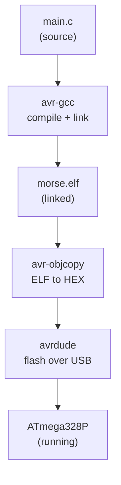

import TawkWidget from '../../../../components/TawkWidget.astro';
import UniversalContentContributors from '../../../../components/UniversalContentContributors.astro';
import InArticleAd from '../../../../components/InArticleAd.astro';
import Copyright from '../../../../components/Copyright.astro';
import BionicText from '../../../../components/BionicText.astro';
import TailwindWrapper from '../../../../components/TailwindWrapper.jsx';
import { Tabs, TabItem } from '@astrojs/starlight/components';
import { Card, CardGrid, Badge, Steps, LinkButton, FileTree } from '@astrojs/starlight/components';

<UniversalContentContributors 
  contributors={frontmatter.contributors}
/>


import EmbeddedProgrammingAtmega328pComments from '../../../../components/embedded-programming-atmega328p/EmbeddedProgrammingAtmega328pComments.astro';

import PodcastEmbed from '../../../../components/PodcastEmbed.astro';

The Arduino IDE uploads a program with one click and hides every step, so when a program is too large, runs at the wrong speed, or will not upload, you cannot see which step failed. In this lesson you install the tools yourself (a set called a toolchain) and write a Makefile that compiles C code and sends it to an Arduino Nano or Uno. This is bare-metal programming: your program runs directly on the chip, with no framework under it. The project is a Morse code beacon that blinks your name on the LED. #AVR #BareMetal #CProgramming

<PodcastEmbed src="https://open.spotify.com/episode/4UyRkT8wXCl4d6jTFAlVSY?si=enzl4wB8SPC8nHEllmRy9Q" />

### ATmega328P Pinout Reference

The ATmega328P, the microcontroller on the Nano and the Uno, is one chip with a processor, memory and input/output pins. Code names a pin by port and number (PB5 is pin 5 of port B); the board prints another number beside it (PB5 is "D13"). This diagram translates between the two.


Download the full ATmega328P datasheet from [Microchip (PDF)](https://ww1.microchip.com/downloads/en/DeviceDoc/Atmel-7810-Automotive-Microcontrollers-ATmega328P_Datasheet.pdf) ([archive copy](https://drive.google.com/file/d/1fMLGkKZbYLITJehfF9tpWpZe6VMmuEL0/view?usp=sharing)). Every register and bit name in this course comes from it.

## What We Are Building

<Card title="Morse Code Beacon" icon="star">
A bare-metal C program that turns any text into International Morse Code and blinks it on the built-in LED, which is connected to PB5 (pin 13). One command, `make flash`, builds the program and writes it into the chip's memory, which is called flashing. No external wiring is needed.
</Card>

Here is an [International Morse Code visual reference](https://drive.google.com/file/d/1mzDOp8Rn8YJk5ukaH9R67SuMCmx2IyFG/view?usp=sharing) for the dot-and-dash patterns.

**Project specifications:**

| Parameter | Value |
|-----------|-------|
| MCU | ATmega328P (on Arduino Nano or Uno) |
| Clock | 16 MHz (external crystal) |
| Toolchain | avr-gcc, avr-objcopy, avrdude |
| Build system | GNU Make |
| Programmer | USB serial (CH340/FTDI on Nano, ATmega16U2 on Uno) |
| Output | Built-in LED on PB5 (pin 13) |
| Dot duration | 200 ms |
| Dash duration | 600 ms |
| Optimization | -Os (size) |

### Parts for This Lesson

| Ref | Component | Quantity | Notes |
|-----|-----------|----------|-------|
| 1 | Arduino Nano or Uno (ATmega328P) | 1 | Nano clone with CH340 works fine |
| 2 | USB cable | 1 | Mini-B for most Nanos, Type-B for Uno |

:::tip[Optional: external LED for the exercises]
The last exercise adds a second LED. For that you need a breadboard, an LED, a 220 ohm resistor, and a few jumper wires.
:::

## Installing the AVR Toolchain

<InArticleAd />


The chip cannot read C. It runs machine code, numbers that each mean one small instruction, and tools on your computer translate, each with one job:

- `avr-gcc` is the compiler. It translates C into machine code for AVR chips, the family of the ATmega328P.
- `avr-libc` is the C library. It supplies the register names, such as `PORTB`, and functions such as `_delay_ms()`.
- `avr-objcopy` converts the compiler's output into the file format used for upload.
- `avrdude` is the uploader. It sends that file over USB to the chip.
- `make` runs these tools in the right order.

<Tabs>
<TabItem label="Linux">
```bash
# Ubuntu / Debian
sudo apt update
sudo apt install gcc-avr avr-libc avrdude make

# Fedora
sudo dnf install avr-gcc avr-libc avrdude make

# Arch
sudo pacman -S avr-gcc avr-libc avrdude make
```

Verify the installation:

```bash
avr-gcc --version
avrdude -?
```
</TabItem>
<TabItem label="macOS">
```bash
# Install via Homebrew
brew tap osx-cross/avr
brew install avr-gcc avrdude
```

Verify the installation:

```bash
avr-gcc --version
avrdude -?
```
</TabItem>
<TabItem label="Windows">
On Windows, use [MSYS2](https://www.msys2.org). It installs a maintained avr-gcc and avrdude with a normal installer.

1. Install MSYS2 from https://www.msys2.org and open the **MSYS2 MINGW64** shell from the Start menu.
2. Update the package database (run twice if it asks you to close and reopen the shell):

   ```bash
   pacman -Syu
   ```
3. Install the AVR toolchain:

   ```bash
   pacman -S mingw-w64-x86_64-avr-gcc mingw-w64-x86_64-avr-libc mingw-w64-x86_64-avrdude make
   ```
4. Add `C:\msys64\mingw64\bin` to your system `PATH` so `avr-gcc`, `avrdude`, and `make` work from any terminal (PowerShell, cmd, VS Code).

Open a new terminal and verify:

```bash
avr-gcc --version
avrdude -?
```

Older guides point to WinAVR, which is no longer maintained. Do not use it.
</TabItem>
</Tabs>

## Project Structure

<InArticleAd />


Create a project directory with the following layout:

<FileTree>
- morse-beacon/
  - main.c
  - Makefile
</FileTree>

## The Build and Flash Pipeline

<InArticleAd />


The tools always run in this order. `morse.elf` also holds notes that only the computer needs; `morse.hex` keeps the machine code alone. On the chip the bootloader, a small program already there, receives the bytes and writes them into program memory.



## ATmega328P Memory Map

<InArticleAd />


To read the size report of the build, know the three separate memories of the ATmega328P:

- Flash (32 KB) holds the program and keeps it without power.
- SRAM (2 KB) holds the variables while the program runs. It is lost when power is removed.
- EEPROM (1 KB) holds data the program chooses to save, such as settings, and keeps it without power.

The names with a dot are the compiler's: `.text` is the machine code, `.data` the variables that start with a value, `.bss` the variables that start at zero. The stack is working space that grows and shrinks as the program runs.

```text
  Flash (32 KB)        SRAM (2 KB)       EEPROM (1 KB)
 +--------------+    +--------------+   +--------------+
 | 0x0000       |    | 0x0100       |   | 0x000        |
 | Vector Table |    | .data        |   |              |
 +--------------+    | (initialized)|   | User data    |
 | .text        |    +--------------+   | (persistent) |
 | (your code)  |    | .bss         |   |              |
 |              |    | (zeroed)     |   |              |
 +--------------+    +--------------+   +--------------+
 | .data values |    |   Heap -->   |   | 0x3FF        |
 | (start copy) |    |              |   +--------------+
 +--------------+    |   <-- Stack  |
 | Bootloader   |    +--------------+
 | 0x7FFF       |    | 0x08FF       |
 +--------------+    +--------------+
```

Flash also stores the starting values of the `.data` variables, copied into SRAM at every start, so a table of text uses flash and SRAM at the same time.

## Writing the Makefile

<InArticleAd />


A Makefile stores the three long commands you would otherwise type after every change, so you type only `make flash`. Its top sets the values the commands use:

- `MCU` names the chip.
- `F_CPU` is the clock frequency of the board in hertz. It only tells the compiler, which needs it to calculate delays; it does not set the speed of the chip.
- `BAUD` and `PORT` are the speed and the name of the serial connection that avrdude uploads through.
- `CFLAGS` are the compiler options: `-Os` asks for the smallest program, and `-Wall -Wextra` turn on warnings.

Below them are the rules: a file to make, the file it is made from, and on the next line the command. In a command, `$@` means the file being made and `$<` the file it is made from.

```makefile
# Morse Beacon Makefile
MCU      = atmega328p
F_CPU    = 16000000UL
BAUD     = 115200
PORT     = /dev/ttyUSB0

CC       = avr-gcc
OBJCOPY  = avr-objcopy
CFLAGS   = -mmcu=$(MCU) -DF_CPU=$(F_CPU) -Os -Wall -Wextra -std=c11
TARGET   = morse

all: $(TARGET).hex

$(TARGET).elf: main.c
	$(CC) $(CFLAGS) -o $@ $<

$(TARGET).hex: $(TARGET).elf
	$(OBJCOPY) -O ihex -R .eeprom $< $@
	avr-size --mcu=$(MCU) -C $<

flash: $(TARGET).hex
	avrdude -c arduino -p $(MCU) -P $(PORT) -b $(BAUD) -U flash:w:$<

fuses:
	avrdude -c arduino -p $(MCU) -P $(PORT) -b $(BAUD) -U lfuse:r:-:h -U hfuse:r:-:h -U efuse:r:-:h

clean:
	rm -f $(TARGET).elf $(TARGET).hex

.PHONY: all flash fuses clean
```

:::tip[Download the working files instead of copy-pasting]
Each command line must start with a real tab, and the file must be named exactly `Makefile`, with no extension. Copying from the code block can turn tabs into spaces (the error is `Makefile:15: *** missing separator. Stop.`). Notepad on Windows saves the file as `Makefile.txt` (the error is `No targets specified and no makefile found`).

Download the verified files directly:

- [Makefile](https://raw.githubusercontent.com/SiliconWit/embedded-programming-atmega328p/main/code/avr-toolchain-bare-metal-setup/Makefile)
- [main.c](https://raw.githubusercontent.com/SiliconWit/embedded-programming-atmega328p/main/code/avr-toolchain-bare-metal-setup/main.c)

Or download both from a terminal:

```bash
curl -O https://raw.githubusercontent.com/SiliconWit/embedded-programming-atmega328p/main/code/avr-toolchain-bare-metal-setup/Makefile
curl -O https://raw.githubusercontent.com/SiliconWit/embedded-programming-atmega328p/main/code/avr-toolchain-bare-metal-setup/main.c
```

You can browse the folder at [github.com/SiliconWit/embedded-programming-atmega328p/tree/main/code/avr-toolchain-bare-metal-setup](https://github.com/SiliconWit/embedded-programming-atmega328p/tree/main/code/avr-toolchain-bare-metal-setup).

If you type the Makefile by hand, check it with `cat -A Makefile`. Every command line should start with `^I` (a tab), not spaces.
:::

The ATmega328P has no USB of its own. A second chip on the board (a CH340 or FTDI chip on the Nano) receives USB and passes the bytes on as a serial signal, one bit after another, to pins PD0 and PD1, where the bootloader listens during flashing.

```text
  +-----------+  USB cable  +---------------------------+
  |    PC     |=============|       Arduino Nano        |
  |           |             |                           |
  | Serial    |             |  +--------+   +--------+  |
  | terminal  |<----------->|  | CH340  |<->|ATmega  |  |
  | (115200)  |             |  | USB-to-|   | 328P   |  |
  |           |             |  | serial |   |RXD PD0 |  |
  |           |             |  +--------+   |TXD PD1 |  |
  +-----------+             |               +--------+  |
                            +---------------------------+
```

The default `/dev/ttyUSB0` is typical on Linux; macOS usually shows `/dev/cu.usbserial-XXX`, and Windows something like `COM3`. Set PORT to match your system.

## Writing main.c

<InArticleAd />


The program has three parts:

1. A table, `morse[]`, with the dots and dashes for each letter A to Z.
2. A delay function. `_delay_ms()` makes the processor count clock cycles and do nothing else. The compiler works out how many from `F_CPU`, so a wrong `F_CPU` gives wrong times.3. A loop in `main()` that finds each letter of the message in the table and blinks it.

`DDRB` and `PORTB` are registers: bytes inside the chip whose bits are wired to hardware, so writing one changes what a pin does. `DDRB |= (1 << PB5)` makes pin PB5 an output, and `led_on()` and `led_off()` switch it high and low. The lesson on GPIO registers explains these lines.

```c
#define F_CPU 16000000UL

#include <avr/io.h>
#include <util/delay.h>
#include <string.h>
#include <ctype.h>

/* Morse timing (ms) */
#define DOT_MS    200
#define DASH_MS   600
#define SYMBOL_GAP  200   /* gap between dots/dashes in a letter */
#define LETTER_GAP  400   /* added after the symbol gap: 600 between letters */
#define WORD_GAP    800   /* added after the letter gap: 1400 between words */

/* Morse lookup: A-Z encoded as strings of '.' and '-' */
static const char *morse[] = {
    ".-",   "-...", "-.-.", "-..",  ".",    "..-.", /* A-F */
    "--.",   "....", "..",   ".---", "-.-",  ".-..", /* G-L */
    "--",   "-.",   "---",  ".--.", "--.-", ".-.",  /* M-R */
    "...",   "-",   "..-",  "...-", ".--",  "-..-", /* S-X */
    "-.--", "--.."                                   /* Y-Z */
};

static void led_on(void)  { PORTB |=  (1 << PB5); }
static void led_off(void) { PORTB &= ~(1 << PB5); }

static void delay_ms(uint16_t ms)
{
    while (ms--) _delay_ms(1);
}

static void blink_dot(void)
{
    led_on();
    delay_ms(DOT_MS);
    led_off();
    delay_ms(SYMBOL_GAP);
}

static void blink_dash(void)
{
    led_on();
    delay_ms(DASH_MS);
    led_off();
    delay_ms(SYMBOL_GAP);
}

static void send_char(char c)
{
    if (c == ' ') {
        delay_ms(WORD_GAP);
        return;
    }
    c = toupper((unsigned char)c);
    if (c < 'A' || c > 'Z') return;

    const char *code = morse[c - 'A'];
    for (uint8_t i = 0; code[i]; i++) {
        if (code[i] == '.') blink_dot();
        else                blink_dash();
    }
    delay_ms(LETTER_GAP);
}

int main(void)
{
    /* Set PB5 as output */
    DDRB |= (1 << PB5);

    const char *message = "SAM";  /* Change to your name */

    while (1) {
        for (uint8_t i = 0; i < strlen(message); i++) {
            send_char(message[i]);
        }
        delay_ms(WORD_GAP * 2);  /* Long pause before repeating */
    }
}
```

## Compiling and Flashing

<InArticleAd />


<Steps>
1. Connect the Arduino Nano to your computer via USB.

2. Find your serial port:
   ```bash
   # Linux
   ls /dev/ttyUSB*

   # macOS
   ls /dev/cu.usb*

   # Windows (in Device Manager or)
   mode
   ```

3. Update the PORT variable in your Makefile if needed.

4. Compile and flash:
   ```bash
   make flash
   ```

5. Watch the built-in LED on pin 13. It should blink your name in Morse code, pause, and repeat.
</Steps>

If avrdude reports `not in sync`, the upload speed is wrong: many Nano boards carry an older bootloader that listens at 57600. Set `BAUD = 57600` in the Makefile and run `make flash` again.

## Reading the Fuse Bits

<InArticleAd />


Settings needed before any program runs live in three fuse bytes, stored apart from flash: the clock source, the size of the bootloader area, and the brown-out detector (BOD), which holds the chip in reset when the supply voltage is too low. Reading them confirms that the board runs from its external 16 MHz crystal.

```bash
make fuses
```

Typical Nano/Uno values are below. If all three read as zero, the bootloader ignored the request; only a separate hardware programmer can read the real values.

| Fuse | Value | Meaning |
|------|-------|---------|
| lfuse | 0xFF | External low-power crystal oscillator (8 to 16 MHz), slowly rising power |
| hfuse | 0xDA | 1024-word (2 KB) boot section, SPI programming enabled (an Uno with Optiboot reads 0xDE: 256 words) |
| efuse | 0xFD | BOD at 2.7V |

:::caution
Only read the fuse bytes. A wrong fuse setting can stop the chip from accepting programs, and then only a high-voltage programmer can recover it.
:::

## Understanding the Build Output

<InArticleAd />


`make` runs avr-size, which prints the memory used: "Program" is flash (of 32 KB), "Data" is SRAM (of 2 KB). Most of the 116 bytes of Data are the Morse table, copied into SRAM at every start.

Watch the Data line as projects grow. The stack also lives in SRAM and is not counted here; when Data fills most of the 2 KB, the two overwrite each other and the program fails at random.

```
AVR Memory Usage
----------------
Program:     428 bytes (1.3% Full)
Data:        116 bytes (5.7% Full)
```

## Exercises

<InArticleAd />


1. Change the message string to your full name and observe the LED pattern. Time it with a stopwatch to verify the dot and dash durations.
2. Add Morse codes for digits 0 through 9 to the lookup table. The pattern is systematic: "0" is `-----`, "1" is `.----`, and so on.
3. Modify the Makefile to produce a `.bin` file in addition to `.hex`. Use `avr-objcopy -O binary` for this.
4. Add an external LED on PB0 (pin 8): connect the LED's longer leg (anode) to pin 8 through a 220 ohm resistor, and the shorter leg (cathode, the one with the flat edge on the LED body) to GND. Set PB0 as output with `DDRB |= (1 << PB0)` and blink both LEDs with inverted patterns, one on while the other is off.


## Summary

<InArticleAd />


You can now compile C code with avr-gcc, flash it with avrdude, and read the fuse bytes and the size report. Every later lesson uses this toolchain, so make sure `make flash` works every time before you continue.

<EmbeddedProgrammingAtmega328pComments />


<InArticleAd />
<TawkWidget />
<Copyright />
