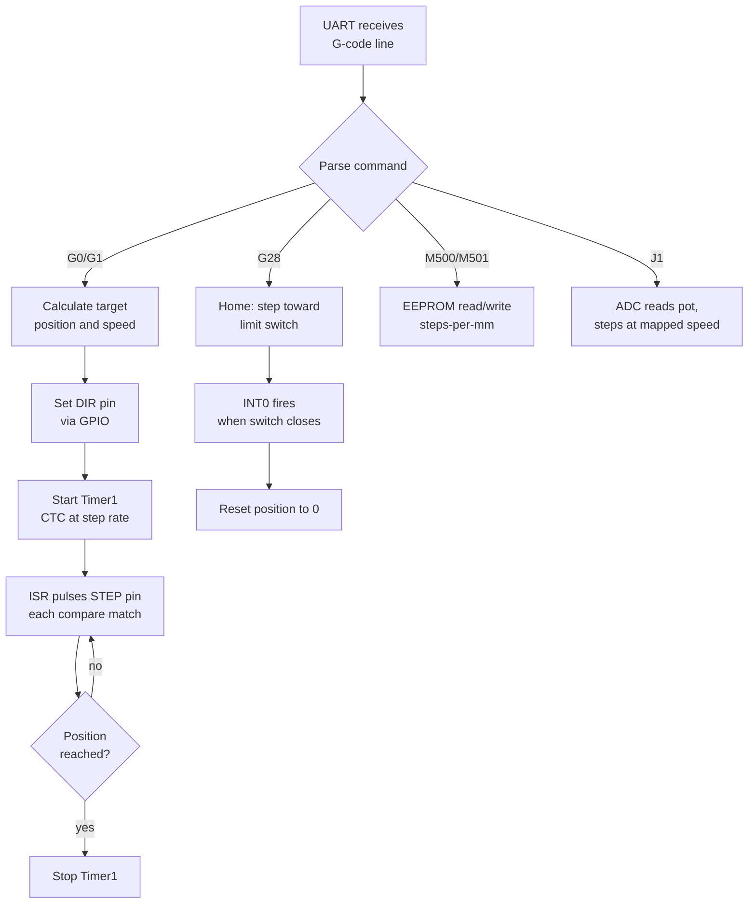

import TawkWidget from '../../../../components/TawkWidget.astro';
import UniversalContentContributors from '../../../../components/UniversalContentContributors.astro';
import InArticleAd from '../../../../components/InArticleAd.astro';
import Copyright from '../../../../components/Copyright.astro';
import BionicText from '../../../../components/BionicText.astro';
import TailwindWrapper from '../../../../components/TailwindWrapper.jsx';
import { Tabs, TabItem } from '@astrojs/starlight/components';
import { Card, CardGrid, Badge, Steps, LinkButton, FileTree } from '@astrojs/starlight/components';

<UniversalContentContributors 
  contributors={frontmatter.contributors}
/>


import EmbeddedProgrammingAtmega328pComments from '../../../../components/embedded-programming-atmega328p/EmbeddedProgrammingAtmega328pComments.astro';

A CNC machine (a machine tool moved by a computer) that misses one step pulse cuts in the wrong place for the rest of the job. The program inside must listen for commands, time every pulse and watch a safety switch, all on one small processor, and no pulse may be late. This lesson builds a controller for one axis of such a machine, using the peripherals of the whole course in one program: it takes movement commands over the serial port, times the step pulses with a timer, finds its zero position with a limit switch, and lets you move the axis by hand with a potentiometer. #StepperMotor #CNC #MotionControl

## What We Are Building

<Card title="Single-Axis Stepper Motor Controller" icon="star">
A motion controller for one linear axis:

- A PC sends movement commands over UART in G-code, the text language of CNC machines.
- Timer1 in CTC mode times the step pulses.
- An A4988 driver module turns the pulses into current for a NEMA 17 stepper motor.
- A limit switch on INT0 marks home, the zero from which positions are counted.
- A 10K potentiometer on ADC channel 0 moves the axis by hand (jogging).
- EEPROM keeps the calibration, the number of steps for one millimeter.

</Card>

**Project specifications:**

| Parameter | Value |
|-----------|-------|
| MCU | ATmega328P on Arduino Nano (16 MHz) |
| Motor | NEMA 17 bipolar stepper (200 steps/rev, 1.8 degrees/step) |
| Driver | A4988 or DRV8825 (full step mode) |
| Motor supply | 12V external |
| Serial | 115200 baud (U2X mode for low error) |
| Default calibration | 25 steps/mm (8 mm pitch leadscrew) |
| Speed range | 10 to 3000+ mm/min |
| Commands | G0, G1, G28, M114, M500, M501, J1 |

## Peripherals Used

<InArticleAd />


No peripheral here is new. Each has one job:

| Peripheral | Where you met it | Role in This Project |
|-----------|--------|---------------------|
| GPIO | [GPIO registers](/education/embedded-programming-atmega328p/gpio-registers-digital-io/) | STEP and DIR pins to A4988 driver |
| Timer1 (CTC) | [Timers](/education/embedded-programming-atmega328p/timer-counter-fundamentals/) | Step pulse timing at a frequency that changes with speed |
| INT0 | [Interrupts](/education/embedded-programming-atmega328p/interrupts-event-driven-design/) | Limit switch interrupt for homing |
| UART | [Serial communication](/education/embedded-programming-atmega328p/uart-serial-communication/) | Receive G-code commands from PC |
| ADC | [Analog inputs](/education/embedded-programming-atmega328p/adc-analog-signal-acquisition/) | Read jog potentiometer for manual control |
| EEPROM | [Power management](/education/embedded-programming-atmega328p/power-management-watchdog-sleep/) | Store and recall steps-per-mm calibration |

## Hardware Setup

<InArticleAd />


A stepper motor does not spin freely like a fan motor. It turns in small fixed steps, 200 to a full turn here, and holds its position between steps, so counting the steps you send gives the position, with no sensor on the shaft.

An MCU pin cannot drive the motor coils: a pin is good for 20 mA, and a coil needs 1 A or more from a 12 V supply. The driver module (A4988 or DRV8825) between the two needs only two logic signals: each rising edge on STEP moves the motor one step, and the level on DIR chooses the direction.

```text
  ATmega328P            A4988 Driver         NEMA 17
  ┌────────┐           ┌───────────┐        ┌───────┐
  │    PD4 ├── STEP ──►│ STEP   1A ├────────┤ Coil  │
  │    PD5 ├── DIR ───►│ DIR    1B ├────────┤   A   │
  │    GND ├───────────┤ GND    2A ├────────┤ Coil  │
  │        │   12V ───►│ VMOT   2B ├────────┤   B   │
  │        │           └───────────┘        └───────┘
  │        │            MS1,MS2,MS3 = GND (full step)
  │        │
  │    PD2 │◄── INT0 ── limit switch (NO) ── GND
  │    PC0 │◄── ADC0 ── wiper of 10K jog pot
  └────────┘
```

- The limit switch is normally open (NO), between PD2 and GND, with the internal pull-up on. The pin reads high until the axis presses the switch.
- The jog potentiometer has its outer pins on VCC and GND and its wiper, the middle pin, on PC0.
- On the A4988, connect VDD to 5V and RST to SLP, and put a 100 uF capacitor across VMOT and GND.
- MS1, MS2 and MS3 select microstepping, which divides each step into smaller ones. On GND they give full steps.

:::caution
Never connect or disconnect the motor while the 12 V supply is on. It can destroy the driver.
:::

### Parts List

| Part | Connection | Notes |
|------|-----------|-------|
| A4988 stepper driver | STEP to PD4, DIR to PD5 | Set current limit before powering motor (see below) |
| NEMA 17 stepper motor | 4 wires to A4988 | 200 steps/rev (1.8 degrees/step) |
| Limit switch (NO) | PD2 to GND | Normally open, closes at home position |
| 10K potentiometer | Wiper to PC0 | VCC and GND on outer pins |
| 12V power supply | A4988 VMOT | Separate from USB 5V |

The current limit is set with the small potentiometer on the A4988 module. Measure the voltage Vref between its wiper and GND; the limit is $I = V_{ref} / (8 \times R_s)$, where $R_s$ is the sense resistor printed near the chip (R050 = 0.05 ohm, R068, R100 = 0.1 ohm). For a 1.0 A motor with R100: $V_{ref} = 1.0 \times 8 \times 0.1 = 0.8$ V. Too much current overheats driver and motor; too little makes it skip steps.

## Step Pulse Timing

<InArticleAd />


The number of pulses sets the distance, and pulses per second set the speed, so the program turns millimeters into pulses and millimeters per minute into a timer setting.

The motor turns a leadscrew, a threaded rod that moves the axis as it turns; its pitch is the distance moved in one turn. With 200 steps per turn and a pitch of 8 mm (common on 3D printers), one millimeter needs $200 / 8 = 25$ steps.

CNC machines give speed as a feedrate F in mm per minute. Divide by 60 for mm per second, then multiply by the steps in one millimeter:

```
steps_per_second = (F / 60) * steps_per_mm
```

For $F = 300$ mm/min with 25 steps/mm: $(300 / 60) \times 25 = 125$ steps per second.

Timer1 counts from 0 up to OCR1A, raises an interrupt (a compare match), and starts again from 0. The interrupt routine (ISR) sends one STEP pulse each time, so the interrupt frequency is the step rate. With a 16 MHz clock and prescaler 64 the timer makes 250,000 counts per second, and:

```
OCR1A = (F_CPU / (prescaler * steps_per_second)) - 1
```

For 125 steps per second: $\text{OCR1A} = 16\,000\,000 / (64 \times 125) - 1 = 1999$. The minus 1 is there because the count starts at 0. Unlike the tone generator there is no factor of 2: the ISR does not toggle the pin, so each compare match is one full step.

At 3000 mm/min the rate is 1250 steps per second and OCR1A = 199. With prescaler 64, the 16-bit range of Timer1 covers speeds from about 4 steps/s ($250\,000 / 65\,536 \approx 3.8$) up to tens of thousands of steps/s.

The controller never measures where the axis is; it counts the pulses it has sent, which is called open-loop control. If the motor misses steps under a heavy load, the count is wrong and the controller does not know, like a person who counts steps in the dark.

`timer1_start()` cuts the step rate and OCR1A to whole numbers, so 10 mm/min at 25 steps/mm really runs at 9.6 mm/min.

## G-code Parser

<InArticleAd />


A G-code command is one line of text. In `G1 X50 F300`, G1 means "move in a straight line", X50 is the target position in mm, and F300 is the feedrate in mm/min. A controller for one axis needs only these commands:

| Command | Meaning | Example |
|---------|---------|---------|
| G0 Xnn | Rapid move to position nn mm | `G0 X0` (go home fast) |
| G1 Xnn Fnnn | Linear move at feedrate | `G1 X50 F300` |
| G28 | Home: move toward limit switch | `G28` |
| M114 | Report current position | `M114` |
| M500 | Save steps/mm to EEPROM | `M500` |
| M501 | Load steps/mm from EEPROM | `M501` |

The parser, the part of the program that reads a command, takes one line from the UART, finds the command letter and the values, and calls the function for that command. Positions are absolute: X50 means "go to 50 mm from home", not "move 50 mm further".

## Complete Firmware

<InArticleAd />


The program is long, but made of blocks you already know. Read the Timer1 ISR first: all motion happens there, one step per interrupt, while the rest of the program only sets a target and waits.

```c
#define F_CPU 16000000UL
#define BAUD 115200
#define UBRR_VAL ((F_CPU / (8UL * BAUD)) - 1)  /* U2X mode */

#include <avr/io.h>
#include <avr/interrupt.h>
#include <avr/eeprom.h>
#include <util/atomic.h>
#include <util/delay.h>
#include <stdlib.h>
#include <string.h>
#include <ctype.h>
#include <math.h>

/* --- Pin definitions --- */
#define STEP_PIN   PD4
#define DIR_PIN    PD5
#define LIMIT_PIN  PD2  /* INT0 */

#define EE_STEPS_MM ((float *)0)  /* EEPROM address for calibration */

/* --- Global state --- */
static volatile int32_t current_pos = 0;   /* steps from home */
static volatile int32_t target_pos  = 0;
static volatile uint8_t moving      = 0;
static volatile uint8_t limit_hit   = 0;
static volatile uint8_t homing      = 0;
static volatile uint8_t home_failed = 0;
static volatile uint16_t home_steps = 0;
static volatile int32_t home_offset = 0;   /* count when the switch closed */
#define HOME_MAX_STEPS 10000  /* 400 mm at 25 steps/mm: longer than the axis */

static float steps_per_mm = 25.0;  /* default: 200 steps/rev, 8mm pitch */
static float feedrate = 300.0;     /* mm/min */
static float rapid_rate = 1000.0;  /* mm/min for G0 */

/* ================================
   UART (with U2X for 115200 baud)
   ================================ */
static void uart_init(void)
{
    UBRR0H = (uint8_t)(UBRR_VAL >> 8);
    UBRR0L = (uint8_t)(UBRR_VAL);
    UCSR0A = (1 << U2X0);  /* Double speed for lower baud error */
    UCSR0B = (1 << TXEN0) | (1 << RXEN0);
    UCSR0C = (1 << UCSZ01) | (1 << UCSZ00);  /* 8N1 */
}

static void uart_putc(char c)
{
    while (!(UCSR0A & (1 << UDRE0)));
    UDR0 = c;
}

static void uart_puts(const char *s)
{
    while (*s) uart_putc(*s++);
}

static void uart_put_i32(int32_t val)
{
    char buf[12];
    ltoa(val, buf, 10);
    uart_puts(buf);
}

static uint8_t uart_available(void)
{
    return (UCSR0A & (1 << RXC0)) ? 1 : 0;
}

static char uart_getc(void)
{
    while (!(UCSR0A & (1 << RXC0)));
    return UDR0;
}

/* Read a full line (up to CR or LF) into buf. Returns length. */
static uint8_t uart_readline(char *buf, uint8_t maxlen)
{
    uint8_t i = 0;
    while (i < maxlen - 1) {
        char c = uart_getc();
        if (c == '\n' || c == '\r') {
            if (i > 0) break;  /* ignore leading newlines */
            continue;
        }
        buf[i++] = toupper(c);
    }
    buf[i] = '\0';
    return i;
}

/* ================================
   ADC (jog potentiometer on PC0)
   ================================ */
static void adc_init(void)
{
    ADMUX = (1 << REFS0);  /* AVcc reference, channel 0 */
    ADCSRA = (1 << ADEN) | (1 << ADPS2) | (1 << ADPS1) | (1 << ADPS0);
}

static uint16_t adc_read(void)
{
    ADCSRA |= (1 << ADSC);
    while (ADCSRA & (1 << ADSC));
    return ADC;
}

/* ================================
   Timer1: step pulse generation
   ================================ */
static void timer1_start(float steps_sec)
{
    if (steps_sec < 4.0) steps_sec = 4.0;  /* Slowest rate that fits in 16 bits */

    /* One step per compare match: OCR1A = F_CPU / (64 * rate) - 1 */
    uint16_t ocr = (uint16_t)(F_CPU / (64UL * (uint32_t)steps_sec) - 1);
    if (ocr < 1) ocr = 1;

    TCCR1A = 0;
    TCCR1B = (1 << WGM12) | (1 << CS11) | (1 << CS10);  /* CTC, prescaler 64 */
    OCR1A = ocr;
    TCNT1 = 0;
    TIMSK1 = (1 << OCIE1A);
    moving = 1;
}

static void timer1_stop(void)
{
    TIMSK1 = 0;
    TCCR1B = 0;
    moving = 0;
}

/* Timer1 compare match: one step per interrupt */
ISR(TIMER1_COMPA_vect)
{
    if (homing) {
        /* Edge seen, or switch already closed when homing began */
        if (limit_hit || !(PIND & (1 << LIMIT_PIN))) {
            timer1_stop();
            home_offset = current_pos;  /* 0 if no step was lost */
            current_pos = 0;
            target_pos = 0;
            homing = 0;
            return;
        }
        if (++home_steps > HOME_MAX_STEPS) {
            /* The switch never closed (broken wire or switch): stop,
               do not drive the axis into its end for ever */
            timer1_stop();
            home_failed = 1;
            homing = 0;
            return;
        }
        /* Step toward home (negative direction) */
        PORTD |= (1 << STEP_PIN);
        _delay_us(2);  /* A4988 needs 1 us high, DRV8825 1.9 us */
        PORTD &= ~(1 << STEP_PIN);
        current_pos--;
        return;
    }

    if (current_pos == target_pos) {
        timer1_stop();
        return;
    }

    /* Pulse the STEP pin */
    PORTD |= (1 << STEP_PIN);
    _delay_us(2);  /* A4988 needs 1 us high, DRV8825 1.9 us */
    PORTD &= ~(1 << STEP_PIN);

    if (current_pos < target_pos) current_pos++;
    else current_pos--;
}

/* ================================
   INT0: limit switch
   ================================ */
ISR(INT0_vect)
{
    limit_hit = 1;
}

/* ================================
   Motion commands
   ================================ */
static void move_to(float pos_mm, float rate_mm_min)
{
    int32_t target = lround(pos_mm * steps_per_mm);  /* Nearest step */
    int32_t diff;

    ATOMIC_BLOCK(ATOMIC_RESTORESTATE) {
        target_pos = target;
        diff = target_pos - current_pos;
    }

    if (diff == 0) return;

    /* Set direction */
    uint8_t toward_home = (diff < 0);
    if (toward_home) PORTD &= ~(1 << DIR_PIN);
    else PORTD |= (1 << DIR_PIN);

    limit_hit = 0;  /* Forget the edge left over from homing */

    float steps_sec = (rate_mm_min / 60.0) * steps_per_mm;
    timer1_start(steps_sec);

    /* Wait for move to complete */
    while (moving) {
        /* Stop if the limit switch closes while moving toward home */
        if (limit_hit && toward_home) {
            timer1_stop();
            uart_puts("!! Limit hit during move\n");
            break;
        }
    }
}

static void do_home(void)
{
    uart_puts("Homing...\n");
    limit_hit = 0;
    home_failed = 0;
    home_steps = 0;
    homing = 1;

    /* Move in negative direction toward limit switch */
    PORTD &= ~(1 << DIR_PIN);

    float home_speed = 200.0;  /* mm/min */
    float steps_sec = (home_speed / 60.0) * steps_per_mm;
    timer1_start(steps_sec);

    while (homing);  /* Wait for the limit switch, or the travel limit */

    if (home_failed) {
        uart_puts("Homing failed: limit switch not found\n");
        return;
    }
    /* The count when the switch closed: 0 means no step was lost
       since the last homing (meaningless on the first one) */
    uart_puts("Home found, count was ");
    uart_put_i32(home_offset);
    uart_puts(". Position reset to 0.\n");
}

/* ================================
   Jog mode (potentiometer control)
   ================================ */
static void jog_check(void)
{
    uint16_t adc = adc_read();

    /* Dead zone in center (480-544): no movement */
    if (adc > 480 && adc < 544) return;

    /* Map ADC to speed: further from center = faster */
    float speed;
    if (adc >= 544) {
        PORTD |= (1 << DIR_PIN);   /* Forward */
        speed = (float)(adc - 544) / 480.0 * 600.0;  /* 0-600 mm/min */
    } else {
        if (!(PIND & (1 << LIMIT_PIN))) return;  /* At the switch: no further */
        PORTD &= ~(1 << DIR_PIN);  /* Reverse */
        speed = (float)(480 - adc) / 480.0 * 600.0;
    }

    if (speed < 10.0) return;

    /* Single step at computed rate */
    float steps_sec = (speed / 60.0) * steps_per_mm;
    uint32_t delay_us = (uint32_t)(1000000.0 / steps_sec);
    if (delay_us < 100) delay_us = 100;

    PORTD |= (1 << STEP_PIN);
    _delay_us(2);
    PORTD &= ~(1 << STEP_PIN);

    if (PORTD & (1 << DIR_PIN)) current_pos++;
    else current_pos--;

    /* Simple delay for step rate */
    for (uint32_t i = 0; i < delay_us / 10; i++) {
        _delay_us(10);
    }
}

/* ================================
   G-code parser
   ================================ */
static float parse_value(const char *line, char letter)
{
    const char *p = line;
    while (*p) {
        if (*p == letter) {
            return atof(p + 1);
        }
        p++;
    }
    return -1.0;
}

static void process_line(const char *line)
{
    if (line[0] == 'G') {
        int cmd = atoi(line + 1);
        float x, f;

        switch (cmd) {
            case 0:  /* G0: rapid move */
                x = parse_value(line, 'X');
                if (x >= 0) move_to(x, rapid_rate);
                break;

            case 1:  /* G1: linear move */
                f = parse_value(line, 'F');
                if (f > 0) feedrate = f;
                x = parse_value(line, 'X');
                if (x >= 0) move_to(x, feedrate);
                break;

            case 28: /* G28: home */
                do_home();
                break;

            default:
                uart_puts("Unknown G command\n");
        }
    } else if (line[0] == 'M') {
        int cmd = atoi(line + 1);

        switch (cmd) {
            case 114: /* M114: report position */
                uart_puts("X:");
                uart_put_i32(current_pos);
                uart_puts(" steps (");
                {
                    int32_t um = (int32_t)(current_pos * 1000.0 / steps_per_mm);
                    uart_put_i32(um / 1000);
                    uart_putc('.');
                    int32_t frac = um % 1000;
                    if (frac < 0) frac = -frac;
                    if (frac < 100) uart_putc('0');
                    if (frac < 10) uart_putc('0');
                    uart_put_i32(frac);
                }
                uart_puts(" mm)\n");
                break;

            case 500: /* M500: save calibration */
                eeprom_update_float(EE_STEPS_MM, steps_per_mm);
                uart_puts("Saved steps/mm: ");
                uart_put_i32((int32_t)steps_per_mm);
                uart_putc('\n');
                break;

            case 501: /* M501: load calibration */
                {
                    float val = eeprom_read_float(EE_STEPS_MM);
                    if (val > 0.0 && val < 10000.0) {
                        steps_per_mm = val;
                        uart_puts("Loaded steps/mm: ");
                        uart_put_i32((int32_t)steps_per_mm);
                        uart_putc('\n');
                    } else {
                        uart_puts("No valid calibration in EEPROM\n");
                    }
                }
                break;

            default:
                uart_puts("Unknown M command\n");
        }
    } else if (line[0] == 'J') {
        /* J1: enter jog mode, J0: exit */
        if (line[1] == '1') {
            uart_puts("Jog mode (pot controls speed). Send J0 to exit.\n");
            while (1) {
                jog_check();
                if (uart_available()) {
                    char c = uart_getc();
                    if (c == 'J' || c == 'j') break;
                }
            }
            /* Drop the rest of "J0" and the line end, or the parser
               would read them as a command */
            _delay_ms(5);
            while (uart_available()) (void)uart_getc();
            uart_puts("Jog mode exited.\n");
        }
    } else if (line[0] != '\0') {
        uart_puts("? ");
        uart_puts(line);
        uart_putc('\n');
    }
}

/* ================================
   Main
   ================================ */
int main(void)
{
    /* GPIO setup */
    DDRD |= (1 << STEP_PIN) | (1 << DIR_PIN);

    /* Limit switch on PD2 (INT0): input with pull-up */
    DDRD &= ~(1 << LIMIT_PIN);
    PORTD |= (1 << LIMIT_PIN);

    /* INT0: falling edge (switch closes to GND) */
    EICRA = (1 << ISC01);
    EIMSK = (1 << INT0);

    uart_init();
    adc_init();
    sei();

    /* Load calibration from EEPROM */
    float saved = eeprom_read_float(EE_STEPS_MM);
    if (saved > 0.0 && saved < 10000.0) {
        steps_per_mm = saved;
    }

    uart_puts("\n--- ATmega328P Stepper Controller ---\n");
    uart_puts("Commands: G0 X50, G1 X25 F300, G28, M114, M500, M501, J1\n");
    uart_puts("Steps/mm: ");
    uart_put_i32((int32_t)steps_per_mm);
    uart_puts("\n> ");

    char line[64];

    while (1) {
        uart_readline(line, sizeof(line));
        process_line(line);
        uart_puts("> ");
    }
}
```

## How the Peripherals Work Together

<InArticleAd />




Work that must happen on time is done by hardware and interrupts, and work that can wait is done in the main loop:

- Timer1 owns the step timing. Its ISR is short (pulse the pin, update the count, check the target), so it finishes long before the next step is due.
- INT0 answers the limit switch at once: even while the main loop waits for UART input, its ISR sets `limit_hit`.
- UART talks to the person at the PC. The main loop waits in `uart_readline()`, which is acceptable because Timer1 and INT0 do not depend on the main loop.
- The ADC is read only in jog mode, by polling; it needs no interrupt, because jog steps are made in the main loop.
- EEPROM keeps the calibration when power is off; `eeprom_update_float` writes only if the value changed, which saves write cycles.
- GPIO sets the direction before each move and makes the step pulse (high, then low) inside the ISR.

:::tip[Instrument it]
A stepper's weakness is that it fails silently: overload it and it skips steps, and the open-loop controller never knows, so the job finishes in the wrong place. Add a magnetic encoder (AS5600) or an optical encoder on the shaft to compare commanded steps against real position, and missed steps become visible the instant they happen. An [ESP32 or STM32](/education/sensor-actuator-interfacing-stm32/) reads it, closes the loop, and can [stop the job](https://siliconwit.io) rather than ruin the part, turning open-loop control into closed-loop confidence.
:::

## Testing the Controller

<InArticleAd />


Connect via a serial terminal at 115200 baud. Try these commands in order:

<Steps>
1. **Home the axis**
   ```
   G28
   ```
   The motor moves toward the limit switch. When the switch triggers, position resets to 0.

2. **Move to a position**
   ```
   G1 X20 F300
   ```
   Move to 20 mm at 300 mm/min. The move should take 4 seconds: 300 mm/min is 5 mm/s, and $20 / 5 = 4$.

3. **Check position**
   ```
   M114
   ```
   Should report `X:500 steps (20.000 mm)` with default 25 steps/mm.

4. **Rapid move back**
   ```
   G0 X0
   ```
   Returns to home position at rapid speed.

5. **Try jog mode**
   ```
   J1
   ```
   Turn the potentiometer. Center = stopped, left = reverse, right = forward. Speed increases with distance from center. Send `J0` to exit.
</Steps>

### Check it

An open-loop axis can lose steps without a sign, so measure it. Home (`G28`), repeat `G1 X100 F300` and `G0 X0` ten times, and home again: `Home found, count was N` should give N = 0, or 1 to 2 (the switch's own repeatability). A larger N means lost steps: lower `rapid_rate` (with no acceleration ramp a motor stalls if started too fast for its load) or raise the driver current. In a simulation, `G1 X20 F300` gave exactly 500 steps in 3.99 s, and with the switch wire pulled homing stopped after 10,000 steps with `Homing failed: limit switch not found`.

With a normally-open switch a broken wire looks like "not home"; the step limit stops the axis. Field machines use normally-closed limit switches, so a broken wire reads as "pressed" (the test in the program then turns over).


## Calibrating Steps Per Millimeter

<InArticleAd />


The default 25 steps/mm assumes a 200-step motor and an 8 mm pitch leadscrew; on another machine every move is too long or too short by the same ratio. To calibrate:

<Steps>
1. Home the axis: `G28`
2. Command a known distance: `G1 X100 F200`
3. Measure the actual distance traveled with a ruler or calipers
4. Calculate: `new_steps_mm = 25.0 * (100.0 / actual_mm)`. If the axis moved only 98.4 mm, it needs more steps for each millimeter: $25.0 \times 100 / 98.4 = 25.4$.
5. Update in code and reflash, or implement an M92 command to set it at runtime
6. Save to EEPROM: `M500`
</Steps>

## Exercises

<InArticleAd />


1. Add trapezoidal acceleration: instead of starting at full speed, ramp up the step rate over the first portion of a move and ramp down at the end. This prevents the motor from stalling on fast moves and produces smoother motion. Hint: adjust OCR1A inside the ISR using a step counter and a precomputed acceleration table.
2. Implement `M92 Snn` to set steps-per-mm at runtime without reflashing. Combined with M500, this lets you calibrate from the serial terminal.
3. Add a second axis (Y) using Timer0 and two more GPIO pins. Parse `G1 X20 Y30 F300` and coordinate the two axes so they finish at the same time (the slower axis runs at a proportionally lower step rate).
4. Replace the blocking `while (moving)` wait in `move_to()` with a state machine in the main loop. This lets the controller receive and queue the next command while the current move is still executing, similar to how real CNC controllers work.

## Summary

<InArticleAd />


A stepper axis is moved by counting pulses: their number sets the distance and their rate sets the speed. Timer1 times the pulses, GPIO sends them, INT0 watches the limit switch, UART receives commands, the ADC reads the jog potentiometer, and EEPROM keeps the calibration. Work that must happen on time is done in interrupts. The controller is open-loop: it knows the position only by counting, so it must home first. Grbl, the firmware of many small CNC machines, runs on this same ATmega328P and is built in the same way.

<EmbeddedProgrammingAtmega328pComments />


<InArticleAd />
<TawkWidget />
<Copyright />
