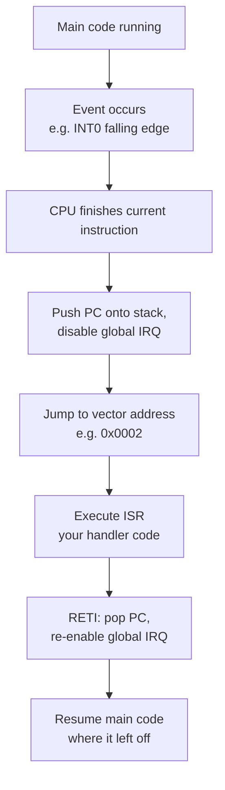
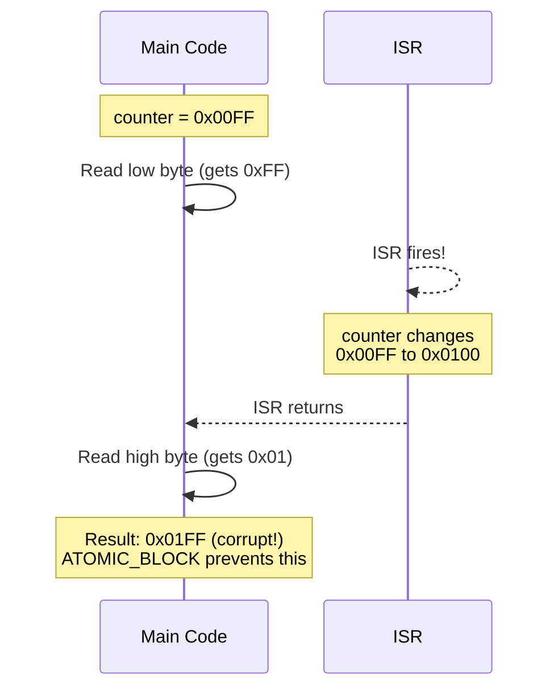

import TawkWidget from '../../../../components/TawkWidget.astro';
import UniversalContentContributors from '../../../../components/UniversalContentContributors.astro';
import InArticleAd from '../../../../components/InArticleAd.astro';
import Copyright from '../../../../components/Copyright.astro';
import BionicText from '../../../../components/BionicText.astro';
import TailwindWrapper from '../../../../components/TailwindWrapper.jsx';
import { Tabs, TabItem } from '@astrojs/starlight/components';
import { Card, CardGrid, Badge, Steps, LinkButton, FileTree } from '@astrojs/starlight/components';

<UniversalContentContributors 
  contributors={frontmatter.contributors}
/>


import PodcastEmbed from '../../../../components/PodcastEmbed.astro';

import EmbeddedProgrammingAtmega328pComments from '../../../../components/embedded-programming-atmega328p/EmbeddedProgrammingAtmega328pComments.astro';

A program that reads a button once in each pass of its loop is polling. If the loop is busy for 20 ms, a 2 ms pulse comes and goes unseen. To miss nothing, the program must check all the time and do no other work. With an interrupt, the hardware watches the event and makes the processor run a short piece of your code at the moment it happens. In this lesson a button interrupt and a timer interrupt make a reaction time tester: an LED lights at a random moment, you press a button, and the board reports your reaction time in milliseconds. #Interrupts #ISR #EventDriven

<PodcastEmbed src="https://open.spotify.com/episode/6TNUlZqNPsXlYCVHUrP6Ng?si=jMPyQDM_Q9SaDHcOUcBbtg" />

## What We Are Building

<Card title="Reaction Time Tester" icon="star">
The firmware waits a random time (1 to 5 seconds) and lights an LED. A Timer1 interrupt counts milliseconds the whole time. When you press the button, an external interrupt (INT0) sets a flag, and the main loop subtracts two readings of the millisecond counter. The result goes to your computer as text over the USB serial link (the UART, which has its own lesson) at 9600 baud. A press before the LED is reported as a false start. The button pin is never polled.
</Card>

**Project specifications:**

| Parameter | Value |
|-----------|-------|
| MCU | ATmega328P (on Arduino Nano or Uno) |
| Button interrupt | INT0 (PD2), falling edge |
| Timer | Timer1, CTC mode, 1 ms tick |
| LED | PB5 (D13, onboard) |
| Serial output | 9600 baud over USB |
| Random delay | 1000 to 5000 ms (LFSR-based) |
| Resolution | 1 ms |

### Parts for This Lesson

| Ref | Component | Quantity | Notes |
|-----|-----------|----------|-------|
| 1 | Arduino Nano or Uno (ATmega328P) | 1 | Already in your kit |
| 2 | Breadboard | 1 | Already in your kit |
| 3 | Push button (tactile) | 1 | Reuse from the electronic dice |
| 4 | Jumper wires | ~4 | Connect button to PD2 |

:::note
The LED is the onboard LED on PB5, and the serial text goes through the board's USB connection. To read it, open a serial terminal at 9600 baud.
:::


## Interrupt Fundamentals

<InArticleAd />


Polling is like walking to the door every minute to see if someone is there. An interrupt is a doorbell: you do your work, and when the bell rings you stop, answer the door, and return to exactly where you were. The comparison stops being true in one way: by default the chip answers one bell at a time, and other interrupts wait until the first is finished.

The code that answers is the interrupt service routine (ISR). The chart shows what the processor does by itself. Three words in it need a meaning. The program counter (PC) is the address of the next instruction, and it is saved on the stack, an area of SRAM, so the processor can return. The vector is a fixed address in flash that holds a jump to your ISR. IRQ means interrupt request.



The jump to the vector takes at least 4 clock cycles, which is 0.25 microseconds at 16 MHz.

### Interrupt Types on ATmega328P

This lesson uses three kinds. On the pins INT0 and INT1 you choose the edge that fires the interrupt: a falling edge is the moment the pin goes from high to low, as when a button to ground is pressed. Pin-change interrupts work on every pin but fire on any change. Timer interrupts come from inside the chip. The last column names the registers that configure each one.

| Type | Triggers | Pins | Register |
|------|----------|------|----------|
| INT0 | Rising, falling, low level, any change | PD2 | EICRA, EIMSK |
| INT1 | Rising, falling, low level, any change | PD3 | EICRA, EIMSK |
| PCINT0 | Any change on PCINT0..7 | PB0..PB7 | PCICR, PCMSK0 |
| PCINT1 | Any change on PCINT8..14 | PC0..PC6 | PCICR, PCMSK1 |
| PCINT2 | Any change on PCINT16..23 | PD0..PD7 | PCICR, PCMSK2 |
| Timer1 Compare A | TCNT1 matches OCR1A | (internal) | TIMSK1 |
| Timer1 Overflow | TCNT1 overflows | (internal) | TIMSK1 |

## Configuring External Interrupts

<InArticleAd />


The vectors form a table at the start of flash, one entry for each interrupt source. In C you write `ISR(INT0_vect)` and the compiler places the jump in the right entry.

```text
  Address  Source           Name in C
  -------  ---------------  ----------------
  0x0000   RESET            (start of program)
  0x0002   INT0             INT0_vect
  0x0004   INT1             INT1_vect
  0x0006   PCINT0           PCINT0_vect
  0x0008   PCINT1           PCINT1_vect
  0x000A   PCINT2           PCINT2_vect
  0x000C   WDT              WDT_vect
   ...      ...              ...
  0x0016   TIMER1_COMPA     TIMER1_COMPA_vect
   ...      ...              ...
  0x0024   USART_RX         USART_RX_vect
  0x0026   USART_UDRE       USART_UDRE_vect
```

An interrupt fires only when three switches are all on, and each has its own line in the code below:

1. The trigger. Two bits in register EICRA choose what on the INT0 pin counts as an event: low level (00), any change (01), falling edge (10), or rising edge (11).
2. The enable bit of this one interrupt, in register EIMSK.
3. The global enable for all interrupts, which `sei()` switches on.

To see how vector tables fit into the processor, read [Digital Electronics: Microcontroller Architecture Overview](/education/digital-electronics/microcontroller-architecture-overview/).

```c
/* INT0 on falling edge */
EICRA |= (1 << ISC01);   /* ISC01=1, ISC00=0: falling edge */
EICRA &= ~(1 << ISC00);
EIMSK |= (1 << INT0);    /* Enable INT0 */
sei();                     /* Global interrupt enable */
```

### ISR Rules

An ISR can run between any two instructions of the main code. Three rules prevent the faults this causes:

- Keep the ISR short. While it runs, all other interrupts wait. Set a flag or store a value, and let the main loop do the slow work, such as sending text.
- Declare every variable that the ISR and the main code share as `volatile`. The compiler cannot see that an ISR changes it, so without this word it may read the variable once and reuse the old value for ever.
- Read a shared variable of more than one byte inside an atomic block, explained at the end of this lesson.

The example shows the form of an ISR. It stores TCNT1, the counter register of Timer1. The ISR of the complete firmware only sets the flag.

```c
#include <avr/interrupt.h>
#include <util/atomic.h>

volatile uint16_t reaction_ms = 0;
volatile uint8_t  button_flag = 0;

ISR(INT0_vect)
{
    reaction_ms = TCNT1;  /* Capture timer value */
    button_flag = 1;
}
```

## Timer1 as a Millisecond Counter

<InArticleAd />


To time a reaction, the program needs a clock that counts milliseconds. Timer1 runs in CTC mode, the mode of the tone generator, where the counter returns to 0 when it reaches OCR1A. Here the match does not toggle a pin. It raises an interrupt, and the ISR adds 1 to a variable.

The numbers: with prescaler 64 the timer clock is 16,000,000 / 64 = 250,000 Hz, so one count lasts 4 microseconds. With OCR1A = 249 the counter passes through 250 values (0 to 249), and 250 × 4 microseconds = 1 ms exactly. So the ISR runs 1,000 times a second.

`ms_counter` is 16-bit, so it returns to 0 after 65,535 ms. The firmware subtracts two readings, and unsigned subtraction stays correct across that return for any interval under 65 seconds.

```c
volatile uint16_t ms_counter = 0;

void timer1_init(void)
{
    /* CTC mode, prescaler 64 */
    TCCR1A = 0;
    TCCR1B = (1 << WGM12) | (1 << CS11) | (1 << CS10);
    OCR1A = 249;             /* 1 ms period */
    TIMSK1 = (1 << OCIE1A); /* Compare match A interrupt */
}

ISR(TIMER1_COMPA_vect)
{
    ms_counter++;
}
```

## Complete Firmware

<InArticleAd />


The four `uart_` functions only send text to the computer. Each round waits a random time while it watches the flag for a false start, lights the LED, waits for the flag again, and prints the difference of two `get_ms()` readings.

```c
#define F_CPU 16000000UL
#define BAUD 9600
#define UBRR_VAL ((F_CPU / (16UL * BAUD)) - 1)

#include <avr/io.h>
#include <avr/interrupt.h>
#include <util/delay.h>
#include <util/atomic.h>
#include <stdlib.h>

/* --- UART --- */
static void uart_init(void)
{
    UBRR0H = (uint8_t)(UBRR_VAL >> 8);
    UBRR0L = (uint8_t)(UBRR_VAL);
    UCSR0B = (1 << TXEN0);
    UCSR0C = (1 << UCSZ01) | (1 << UCSZ00);  /* 8N1 */
}

static void uart_putc(char c)
{
    while (!(UCSR0A & (1 << UDRE0)));
    UDR0 = c;
}

static void uart_puts(const char *s)
{
    while (*s) uart_putc(*s++);
}

static void uart_putu16(uint16_t val)
{
    char buf[6];
    utoa(val, buf, 10);
    uart_puts(buf);
}

/* --- Timing --- */
volatile uint16_t ms_counter = 0;
volatile uint8_t  button_flag = 0;

ISR(TIMER1_COMPA_vect)
{
    ms_counter++;
}

ISR(INT0_vect)
{
    button_flag = 1;
}

static void timer1_init(void)
{
    TCCR1A = 0;
    TCCR1B = (1 << WGM12) | (1 << CS11) | (1 << CS10);
    OCR1A = 249;
    TIMSK1 = (1 << OCIE1A);
}

static uint16_t get_ms(void)
{
    uint16_t val;
    ATOMIC_BLOCK(ATOMIC_RESTORESTATE) {
        val = ms_counter;
    }
    return val;
}

/* --- LFSR for random delays --- */
static uint16_t lfsr = 0xBEEF;

static uint16_t random_delay(void)
{
    uint8_t lsb = lfsr & 1;
    lfsr >>= 1;
    if (lsb) lfsr ^= 0xB400;
    return 1000 + (lfsr % 4001);  /* 1000 to 5000 ms */
}

/* --- Main --- */
int main(void)
{
    /* LED on PB5 */
    DDRB |= (1 << PB5);
    PORTB &= ~(1 << PB5);

    /* Button on PD2 (INT0), input with pull-up */
    DDRD &= ~(1 << PD2);
    PORTD |= (1 << PD2);

    /* INT0: falling edge */
    EICRA = (1 << ISC01);
    EIMSK = (1 << INT0);

    uart_init();
    timer1_init();
    sei();

    uart_puts("Reaction Time Tester\r\n");
    uart_puts("Wait for the LED, then press the button!\r\n\r\n");

    while (1) {
        /* Reset state */
        button_flag = 0;
        PORTB &= ~(1 << PB5);

        uart_puts("Get ready...\r\n");

        /* Random wait */
        uint16_t wait = random_delay();
        uint16_t start = get_ms();

        /* Check for false start during wait */
        uint8_t false_start = 0;
        while ((get_ms() - start) < wait) {
            if (button_flag) {
                false_start = 1;
                break;
            }
        }

        if (false_start) {
            uart_puts("False start! Wait for the LED.\r\n\r\n");
            button_flag = 0;
            _delay_ms(2000);
            continue;
        }

        /* Light the LED and start timing */
        PORTB |= (1 << PB5);
        button_flag = 0;
        uint16_t led_on_time = get_ms();

        /* Wait for button press (up to 3 seconds) */
        while (!button_flag) {
            if ((get_ms() - led_on_time) > 3000) break;
        }

        PORTB &= ~(1 << PB5);

        if (button_flag) {
            uint16_t reaction = get_ms() - led_on_time;
            uart_puts("Reaction time: ");
            uart_putu16(reaction);
            uart_puts(" ms\r\n\r\n");
        } else {
            uart_puts("Too slow! (over 3 seconds)\r\n\r\n");
        }

        _delay_ms(2000);  /* Pause before next round */
    }
}
```

## Pin-Change Interrupts

<InArticleAd />


INT0 and INT1 give you only two pins. Pin-change interrupts (PCINTs) work on all 23 I/O pins, with two limits:

- They fire on any change, rising or falling. The ISR must read the pin to learn which one happened.
- The pins share three ISRs, one for each port. If several pins of a port are enabled, the ISR must also find which pin changed.

```c
/* Enable pin-change interrupt on PB0 (PCINT0) */
PCICR  |= (1 << PCIE0);     /* Enable PCINT group 0 (PB0..PB7) */
PCMSK0 |= (1 << PCINT0);    /* Enable PCINT0 specifically */

ISR(PCINT0_vect)
{
    /* Check if PB0 went low (button press) */
    if (!(PINB & (1 << PB0))) {
        /* Handle press */
    }
}
```

## Atomic Access to Shared Variables

<InArticleAd />


The ATmega328P is an 8-bit processor, so it reads a 16-bit variable in two steps, one byte at a time. An interrupt can arrive between the two steps. Then the main code holds one byte from before the ISR and one from after it. In the chart the counter goes from 0x00FF (255) to 0x0100 (256), and the main code reads 0x01FF, which is 511.



The fault is rare, so it passes every test on the bench and appears weeks later. `ATOMIC_BLOCK` from `util/atomic.h` switches interrupts off for the few instructions of the read and then restores them, so both bytes belong to the same value. A one-byte variable such as `button_flag` is read in one step and does not need it.

```c
#include <util/atomic.h>

volatile uint16_t shared_counter;

/* Safe read from main code */
uint16_t safe_read(void)
{
    uint16_t val;
    ATOMIC_BLOCK(ATOMIC_RESTORESTATE) {
        val = shared_counter;
    }
    return val;
}
```

## Exercises

<InArticleAd />


1. Replace INT0 with a pin-change interrupt on a different pin (for example PB0). You will need to determine edge direction in the ISR by reading the pin state.
2. Add a "best time" tracker that remembers the fastest reaction across multiple rounds and prints it after each attempt.
3. Implement a multi-player version: two buttons on INT0 and INT1, and the firmware reports which player reacted first and by how many milliseconds.
4. Replace the busy-wait random delay with a sleep-based approach: put the CPU in Idle mode and wake it with the timer interrupt. Measure the current difference with a multimeter.

## Summary

<InArticleAd />


An interrupt makes the processor leave the main code, run a short ISR, and return. It fires only when its trigger, its own enable bit and the global enable are all set. Keep each ISR short, declare shared variables `volatile`, and read shared variables of more than one byte inside an atomic block. Later lessons use the same pattern for serial data and sensor sampling.

<EmbeddedProgrammingAtmega328pComments />


<InArticleAd />
<TawkWidget />
<Copyright />
