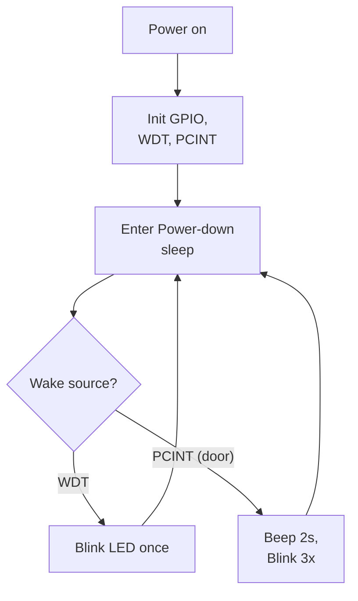

import TawkWidget from '../../../../components/TawkWidget.astro';
import UniversalContentContributors from '../../../../components/UniversalContentContributors.astro';
import InArticleAd from '../../../../components/InArticleAd.astro';
import Copyright from '../../../../components/Copyright.astro';
import BionicText from '../../../../components/BionicText.astro';
import TailwindWrapper from '../../../../components/TailwindWrapper.jsx';
import { Tabs, TabItem } from '@astrojs/starlight/components';
import { Card, CardGrid, Badge, Steps, LinkButton, FileTree } from '@astrojs/starlight/components';

<UniversalContentContributors 
  contributors={frontmatter.contributors}
/>


import EmbeddedProgrammingAtmega328pComments from '../../../../components/embedded-programming-atmega328p/EmbeddedProgrammingAtmega328pComments.astro';

You fit a battery sensor in the field, and three weeks later it is dead. The program was correct, but it was awake all the time, and an awake ATmega328P takes a thousand times more current than a sleeping one: milliamps against microamps. This lesson shows how to put the chip to sleep, which events can wake it, which small currents empty the battery while nobody watches, and how the watchdog timer restarts a program that has stopped. You build a door alert on two AA batteries: it sleeps, wakes when the door opens, sounds a buzzer, and sleeps again. #PowerManagement #SleepModes #LowPower

## What We Are Building

<Card title="Battery-Powered Door Open Alert" icon="star">
A device on two AA batteries (3V) watches a door with a magnetic reed switch, a switch that a magnet closes. When the door opens, the magnet moves away, the switch opens, and that change wakes the MCU (the microcontroller) from its deepest sleep; the firmware sounds a piezo buzzer for 2 seconds, blinks an LED 3 times, and sleeps again. Every 8 seconds a watchdog timer wakes the chip to blink the LED once, a sign that the device still works. Asleep, the MCU draws about 4 microamps.
</Card>

**Project specifications:**

| Parameter | Value |
|-----------|-------|
| MCU | ATmega328P (standalone, 8 MHz internal oscillator) |
| Power source | 2x AA batteries (3V nominal) |
| Sleep mode | Power-down (deepest) |
| Sleep current | About 4 uA for the MCU (watchdog running, BOD disabled) |
| Active current | ~5 mA at 3V, 8 MHz |
| Wake sources | Pin-change interrupt (reed switch), watchdog timer |
| Alert output | Piezo buzzer (PB1), LED (PB0) |
| Watchdog heartbeat | Every 8 seconds |
| Battery life estimate | Over 1 year on 2x AA (2500 mAh) |

### Parts for This Lesson

| Ref | Component | Quantity | Notes |
|-----|-----------|----------|-------|
| 1 | ATmega328P-PU (DIP-28) | 1 | Standalone chip (not on Nano) |
| 2 | 2x AA battery holder | 1 | With leads or JST connector |
| 3 | AA batteries | 2 | Alkaline or lithium |
| 4 | Magnetic reed switch | 1 | Normally open (NO) type: closed while the magnet is near |
| 5 | Piezo buzzer (passive) | 1 | The buzzer from the timer lesson |
| 6 | LED (any color) | 1 | Low-current type preferred |
| 7 | 220 ohm resistor | 1 | LED current limiting |
| 8 | 100 nF ceramic capacitor | 1 | Decoupling on VCC |
| 9 | Breadboard | 1 | The one you already have |
| 10 | ISP programmer (USBasp or Arduino as ISP) | 1 | For programming standalone chip |

:::note
This lesson uses the ATmega328P chip alone on a breadboard, at 3V, with its internal 8 MHz clock. The Nano cannot show low power: its voltage regulator and USB chip draw several milliamps even when the MCU sleeps. Write and test the code on a Nano if you like, but measure the current on the chip alone.
:::

## ATmega328P Sleep Modes

<InArticleAd />


A running chip uses most of its current to switch thousands of transistors on every clock pulse. Sleep means stopping clocks: the more clocks you stop, the less current the chip takes.

The price: a part whose clock is stopped cannot notice anything, so it cannot wake the chip. It is like a building at night: the more rooms you lock, the fewer doors are left to come in by. Each of the six sleep modes stops a different set of clocks; for each, ask how much current remains and which events can still wake the chip.

| Sleep Mode | Current (typical) | What Stays Running | Wake Sources |
|-----------|-------------------|-------------------|--------------|
| Idle | ~3 mA | All clocks, all peripherals | Any interrupt |
| ADC Noise Reduction | ~1 mA | ADC, Timer2 (async), ext. interrupts | ADC complete, ext. int, Timer2, PCINT |
| Power-save | ~1 uA | Timer2 (async), ext. interrupts | Timer2, ext. int, PCINT |
| Power-down | ~0.1 uA (~4 uA with watchdog) | External interrupts, watchdog if enabled | INT0 and INT1 (low level), PCINT, TWI address match, watchdog |
| Standby | ~0.2 uA | Main oscillator, ext. interrupts | Same as power-down (faster wake) |
| Extended Standby | ~0.2 uA | Main osc, Timer2 (async) | Timer2 + power-down sources |

Power-down is the deepest mode, and the door alert uses it. Every clock is stopped, so only events that need no clock can wake the chip:

- a low level on INT0 or INT1 (the external interrupt pins),
- a pin-change interrupt (PCINT), which fires when a chosen pin changes level,
- the watchdog timer, which has its own oscillator,
- an I2C (TWI) address match.

An edge on INT0 or INT1 does not wake the chip from power-down, because edge detection needs the clock; that is why the door alert uses a pin-change interrupt.

### Entering Sleep Mode

The program stops at `sleep_cpu()`. When an interrupt wakes the chip, its routine runs first, then the program continues on the next line. If interrupts are off when the chip goes to sleep, only a reset can wake it.

```c
#include <avr/sleep.h>

/* Select sleep mode */
set_sleep_mode(SLEEP_MODE_PWR_DOWN);

/* Enable sleep, enter sleep, disable sleep after waking */
sleep_enable();
sei();          /* Interrupts must be enabled to wake */
sleep_cpu();    /* CPU halts here until interrupt */
sleep_disable();
```

## Reducing Power Consumption

<InArticleAd />


The sleep instruction alone does not give microamps: some parts use current that does not depend on the clock, and keep using it during sleep unless you switch them off first. The target is 4 microamps, and one part left on can take 20 microamps or more:

- The ADC and the analog comparator (a circuit that compares two pin voltages) draw current while they are enabled.
- PRR (Power Reduction Register) has one bit for each timer and serial interface; setting a bit stops that part.
- An input pin connected to nothing floats between low and high, and its input circuit draws current. A pull-up gives it a definite level.
- BOD (brown-out detection) resets the chip when the supply falls too low. It takes 15 to 20 microamps, so it is switched off during sleep.

### Power Reduction Checklist

<Steps>
1. Disable the ADC before sleeping:
   ```c
   ADCSRA &= ~(1 << ADEN);
   ```

2. Shut down unused peripherals via PRR:
   ```c
   PRR = (1 << PRTWI) | (1 << PRTIM2) | (1 << PRTIM0)
       | (1 << PRTIM1) | (1 << PRSPI) | (1 << PRUSART0)
       | (1 << PRADC);
   ```

3. Set all unused pins as inputs with pull-ups enabled, so that no pin floats:
   ```c
   DDRB = 0x00; PORTB = 0xFF;
   DDRC = 0x00; PORTC = 0xFF;
   DDRD = 0x00; PORTD = 0xFF;
   ```

4. Disable the analog comparator:
   ```c
   ACSR |= (1 << ACD);
   ```

5. Disable BOD during sleep. The chip accepts this only as two writes followed at once by the sleep instruction, so that it cannot happen by accident:
   ```c
   MCUCR |= (1 << BODS) | (1 << BODSE);
   MCUCR = (MCUCR & ~(1 << BODSE)) | (1 << BODS);
   sleep_cpu();  /* Must enter sleep within 3 clock cycles */
   ```
</Steps>

## Watchdog Timer

<InArticleAd />


A device in the field has nobody near it to press reset; if its program stops in an endless loop, it stays stopped until someone visits. The watchdog timer (WDT) is a counter that runs by itself and resets the chip when it reaches its limit. A healthy program sets it back to zero in time with `wdt_reset()`; a program that has stopped does not, and the chip restarts. It is like a night guard who must sign a book every hour: when a signature is missing, someone is sent to look.

The watchdog has its own 128 kHz oscillator, so it keeps counting in power-down sleep. Set to raise an interrupt and not a reset, it wakes the chip at a fixed interval, from 16 ms to 8 seconds. The door alert uses it in this way, so two events can wake it:



### Watchdog Timeout Periods

| WDP3 | WDP2 | WDP1 | WDP0 | Timeout |
|------|------|------|------|---------|
| 0 | 0 | 0 | 0 | 16 ms |
| 0 | 0 | 0 | 1 | 32 ms |
| 0 | 0 | 1 | 0 | 64 ms |
| 0 | 0 | 1 | 1 | 125 ms |
| 0 | 1 | 0 | 0 | 250 ms |
| 0 | 1 | 0 | 1 | 500 ms |
| 0 | 1 | 1 | 0 | 1 s |
| 0 | 1 | 1 | 1 | 2 s |
| 1 | 0 | 0 | 0 | 4 s |
| 1 | 0 | 0 | 1 | 8 s |

### Configuring WDT for Interrupt (Not Reset)

Two bits of WDTCSR choose what a timeout does: WDE (watchdog enable) resets the chip, and WDIE (watchdog interrupt enable) raises an interrupt. For a wakeup at a fixed interval, set WDIE and leave WDE at 0; WDIE then stays set after each timeout. With both bits set, the first timeout raises the interrupt and clears WDIE, and the next one resets the chip unless the program sets WDIE again.

The settings of the watchdog are protected against accidents: the program must write WDCE and WDE together, and then the new settings within four clock cycles.

```c
#include <avr/wdt.h>

static void wdt_setup_interrupt_8s(void)
{
    cli();
    wdt_reset();

    /* Timed sequence to change WDT configuration */
    WDTCSR |= (1 << WDCE) | (1 << WDE);
    /* Interrupt mode, 8s timeout (WDP3=1, WDP0=1) */
    WDTCSR = (1 << WDIE) | (1 << WDP3) | (1 << WDP0);

    sei();
}

ISR(WDT_vect)
{
    /* Watchdog fired. In interrupt-only mode (WDE = 0) WDIE stays set, */
    /* so the next timeout fires again with no action here. */
}
```

## Reed Switch Wiring

<InArticleAd />


The internal 8 MHz oscillator provides the clock, so no crystal is needed. The 100 nF capacitor close to the chip keeps its supply steady (a decoupling capacitor).

```text
       2x AA (3V)
        +  -
        |  |
  +-----+--+---------+
  | VCC    GND        |
  |                   |
  |   ATmega328P-PU   |
  |                   |
  |  PB0---[220R]---[LED]---GND
  |  PB1---[Piezo buzzer]---GND
  |  PD2---[Reed switch]---GND
  |                   |
  |  VCC---[100nF]---GND
  +-------------------+
```

To load the program, connect the USBasp programmer to the MOSI, MISO, SCK, RESET, VCC and GND pins of the chip.

A magnetic reed switch is a glass tube with two thin metal contacts that close when a magnet is near; the common normally-open (NO) type is open with no magnet near. Fit the switch on the door frame and the magnet on the door, wire one terminal to the MCU pin and the other to ground, and enable the internal pull-up on the pin.

- Door closed: the switch is closed and connects the pin to ground. The pin reads low.
- Door open: the switch is open and the pull-up brings the pin high. That change raises the pin-change interrupt.

| Signal | ATmega328P Pin | Connection |
|--------|----------------|------------|
| Reed switch | PD2 (PCINT18) | One terminal to pin, other to GND |
| Piezo buzzer | PB1 (OC1A) | Buzzer between PB1 and GND |
| Status LED | PB0 | LED with 220R to GND |

## EEPROM: Persistent Storage Across Power Cycles

<InArticleAd />


The door alert counts how often the door was opened, and a count in a normal variable is lost when the batteries are changed. Of the three memories you met with the toolchain, only one suits this job:

- Flash keeps the program without power, but it is written only when you load a program.
- SRAM holds the variables, and loses everything when power is removed.
- EEPROM keeps its contents without power, and the running program can write it. It is the place for settings, calibration values and counters.

The ATmega328P has 1024 bytes of EEPROM, each rated for 100,000 writes. Three registers control access:

| Register | Purpose |
|----------|---------|
| EEARH:EEARL | Address (0 to 1023) |
| EEDR | Data byte to read or write |
| EECR | Control: EEMPE (master program enable), EEPE (program enable), EERE (read enable) |

Writing one byte uses a protected sequence, like the watchdog: set the address and data, set the master program bit (EEMPE), then the program bit (EEPE) within four clock cycles. The write takes about 3.3 ms; the CPU keeps running, and the next EEPROM write must wait until EEPE clears. Reading is immediate: the data is in EEDR on the next instruction (the CPU halts for four clock cycles).

You rarely write these registers yourself: `avr/eeprom.h` from avr-libc has functions that do the sequence for you:

```c
#include <avr/eeprom.h>

/* Read a 16-bit word from EEPROM address 0 */
uint16_t count = eeprom_read_word((uint16_t *)0);

/* Write only if the value changed (saves write cycles) */
eeprom_update_word((uint16_t *)0, count + 1);
```

Use `eeprom_update_*`, not `eeprom_write_*`: it reads the byte first and skips the write if the value is already there, which saves writes. At 10 door events per day, 100,000 writes last $100\,000 / (10 \times 365) \approx 27$ years.

The door alert keeps the number of door openings at EEPROM address 0 and adds one at each opening. At power-up the LED blinks the last digit of the count (the count modulo 10), so you can check it without a serial connection.

## Complete Firmware

<InArticleAd />


:::note
This chip runs at 8 MHz, not at the 16 MHz of the Nano. You need a separate Makefile with `F_CPU = 8000000UL` (or remove the `-DF_CPU` flag from CFLAGS and let the source file define it). If you reuse the Makefile from the toolchain lesson without changing F_CPU, the compiler warns about a redefinition and every delay is wrong.
:::

Read `enter_deep_sleep()` first. An interrupt arriving between the check of the two flags and the sleep instruction would set its flag, and the chip would sleep on it for up to 8 seconds. So the function switches interrupts off with `cli()`, checks the flags, and switches them on with `sei()` directly before `sleep_cpu()`. The chip always runs one more instruction after `sei()` before it accepts an interrupt, so no event can slip in between.

```c
#ifndef F_CPU
#define F_CPU 8000000UL  /* Internal 8 MHz RC oscillator */
#endif

#include <avr/io.h>
#include <avr/interrupt.h>
#include <avr/sleep.h>
#include <avr/wdt.h>
#include <avr/eeprom.h>
#include <util/delay.h>

#define LED_PIN    PB0
#define BUZZER_PIN PB1
#define REED_PIN   PD2  /* PCINT18 */

#define EE_DOOR_COUNT ((uint16_t *)0)  /* EEPROM address for door counter */

volatile uint8_t wdt_fired = 0;
volatile uint8_t door_opened = 0;

ISR(WDT_vect)
{
    wdt_fired = 1;
}

ISR(PCINT2_vect)
{
    /* Fires on both edges: pin high means the door opened */
    if (PIND & (1 << REED_PIN)) door_opened = 1;
}

static void delay_ms(uint16_t ms)
{
    while (ms--) _delay_ms(1);
}

static void led_blink(uint8_t count, uint16_t on_ms, uint16_t off_ms)
{
    DDRB |= (1 << LED_PIN);
    for (uint8_t i = 0; i < count; i++) {
        PORTB |= (1 << LED_PIN);
        delay_ms(on_ms);
        PORTB &= ~(1 << LED_PIN);
        delay_ms(off_ms);
    }
}

static void buzzer_beep(uint16_t duration_ms)
{
    /* Use Timer1 CTC for ~1 kHz tone */
    DDRB |= (1 << BUZZER_PIN);
    PRR &= ~(1 << PRTIM1);  /* Enable Timer1 */

    TCCR1A = (1 << COM1A0);  /* Toggle OC1A */
    TCCR1B = (1 << WGM12) | (1 << CS11);  /* CTC, prescaler 8 */
    OCR1A = 499;  /* counts 0-499 (500 steps): 8MHz / (2 * 8 * 500) = 1 kHz */

    delay_ms(duration_ms);

    TCCR1A = 0;
    TCCR1B = 0;
    PORTB &= ~(1 << BUZZER_PIN);

    PRR |= (1 << PRTIM1);  /* Disable Timer1 */
}

static void enter_deep_sleep(void)
{
    /* From here an event stays pending until sei() below */
    cli();
    if (door_opened || wdt_fired) {  /* Arrived while awake: handle it first */
        sei();
        return;
    }

    /* Disable ADC */
    ADCSRA &= ~(1 << ADEN);

    /* Disable analog comparator */
    ACSR |= (1 << ACD);

    /* Power down unused peripherals */
    PRR = (1 << PRTWI) | (1 << PRTIM2) | (1 << PRTIM0)
        | (1 << PRTIM1) | (1 << PRSPI) | (1 << PRUSART0)
        | (1 << PRADC);

    /* Drive the LED and buzzer pins low so that they do not float */
    PORTB &= ~((1 << LED_PIN) | (1 << BUZZER_PIN));
    DDRB |= (1 << LED_PIN) | (1 << BUZZER_PIN);

    /* Keep the watchdog interrupt enabled (needed only if WDE is also set) */
    WDTCSR |= (1 << WDIE);

    set_sleep_mode(SLEEP_MODE_PWR_DOWN);
    sleep_enable();

    /* Disable BOD during sleep (timed sequence) */
    MCUCR |= (1 << BODS) | (1 << BODSE);
    MCUCR = (MCUCR & ~(1 << BODSE)) | (1 << BODS);

    sei();
    sleep_cpu();    /* Sleep here until interrupt */
    sleep_disable();
}

int main(void)
{
    /* Disable watchdog if set by bootloader */
    MCUSR &= ~(1 << WDRF);
    wdt_disable();

    /* All pins: inputs with pull-ups so that none floats (LED and buzzer pins stay low) */
    DDRB = 0x00; PORTB = (uint8_t)~((1 << LED_PIN) | (1 << BUZZER_PIN));
    DDRC = 0x00; PORTC = 0xFF;
    DDRD = 0x00; PORTD = 0xFF;

    /* Reed switch on PD2 (PCINT18): input with pull-up */
    DDRD &= ~(1 << REED_PIN);
    PORTD |= (1 << REED_PIN);

    /* Pin-change interrupt on PD2 (PCINT18): wakes from power-down on any edge */
    PCICR  = (1 << PCIE2);
    PCMSK2 = (1 << PCINT18);

    /* Watchdog: interrupt mode, 8s timeout */
    cli();
    wdt_reset();
    WDTCSR |= (1 << WDCE) | (1 << WDE);
    WDTCSR = (1 << WDIE) | (1 << WDP3) | (1 << WDP0);
    sei();

    /* Read door count from EEPROM and blink it (mod 10) at startup */
    uint16_t door_count = eeprom_read_word(EE_DOOR_COUNT);
    if (door_count == 0xFFFF) door_count = 0;  /* Fresh EEPROM reads as 0xFF */

    uint8_t show = door_count % 10;
    if (show > 0) led_blink(show, 150, 150);
    else led_blink(3, 100, 100);  /* No events yet */

    while (1) {
        enter_deep_sleep();

        /* --- Woke up --- */

        if (door_opened) {
            door_opened = 0;

            /* Increment and save door count */
            door_count++;
            eeprom_update_word(EE_DOOR_COUNT, door_count);

            /* Sound alarm */
            buzzer_beep(2000);
            led_blink(3, 200, 200);

            /* Wait for door to close (debounce) */
            _delay_ms(500);
        }

        if (wdt_fired) {
            wdt_fired = 0;

            /* Heartbeat blink */
            DDRB |= (1 << LED_PIN);
            PORTB |= (1 << LED_PIN);
            _delay_ms(20);
            PORTB &= ~(1 << LED_PIN);
            DDRB &= ~(1 << LED_PIN);
        }
    }
}
```

## Makefile for This Lesson

<InArticleAd />


Copy the Makefile from the toolchain lesson and change the clock and the programmer settings:

```makefile
MCU      = atmega328p
F_CPU    = 8000000UL
CC       = avr-gcc
OBJCOPY  = avr-objcopy
CFLAGS   = -mmcu=$(MCU) -DF_CPU=$(F_CPU) -Os -Wall -Wextra -std=c11
TARGET   = door_alert

all: $(TARGET).hex

$(TARGET).elf: main.c
	$(CC) $(CFLAGS) -o $@ $<

$(TARGET).hex: $(TARGET).elf
	$(OBJCOPY) -O ihex -R .eeprom $< $@
	avr-size --mcu=$(MCU) -C $<

flash: $(TARGET).hex
	avrdude -c usbasp -p $(MCU) -U flash:w:$<

clean:
	rm -f $(TARGET).elf $(TARGET).hex

.PHONY: all flash clean
```

Three things differ from the Nano Makefile: `F_CPU` is 8000000UL (not 16000000UL), the programmer is `usbasp` (not `arduino`), and there is no `-P` port or `-b` baud flag, because the USBasp writes the chip directly over SPI, not through a serial port.

## Fuse Settings for Standalone Operation

<InArticleAd />


Fuses are setting bytes stored in the chip, outside the program, for things the program cannot decide for itself, such as where the clock comes from. A chip taken from an Arduino board is set for an external crystal and does not run without one; a new chip uses the internal oscillator divided by 8, which gives 1 MHz. This program expects 8 MHz with no crystal, so set the fuses for the internal 8 MHz oscillator with no division.

| Fuse | Value | Meaning |
|------|-------|---------|
| lfuse | 0xE2 | Internal 8 MHz RC, 65ms startup, no clock divide |
| hfuse | 0xD9 | No bootloader, SPI enabled, EEPROM erased by a chip erase (use 0xD1 to preserve the door count when you reflash) |
| efuse | 0xFF | BOD disabled (we disable it in software too) |

```bash
# Program fuses with USBasp
avrdude -c usbasp -p m328p \
    -U lfuse:w:0xE2:m \
    -U hfuse:w:0xD9:m \
    -U efuse:w:0xFF:m
```

:::caution
Double-check fuse values before writing. Setting the wrong clock source fuse can make the chip unprogrammable without a high-voltage programmer or an external clock source.
:::

:::tip[Instrument it]
A field sensor has to do two things you never see: last on its battery and recover on its own. Sleep handles the first, dropping the ATmega to microamps between readings so a coin cell lasts; the watchdog handles the second, resetting a node that has hung so it does not silently stop reporting halfway through the season. A monitor you can forget about is one that sleeps deep and restarts itself, then keeps [sending data](/education/iot-systems/) to [siliconwit.io](https://siliconwit.io) without a site visit.
:::

## Measuring Power Consumption

<InArticleAd />


Measure the sleep current: put a multimeter with a microamp range in series with the battery. Expect three different readings:

- Asleep with the door open: about 4 to 6 microamps, mostly the watchdog oscillator (about 4 microamps at 3V). With the watchdog off, the MCU alone would take about 0.1 microamp.
- Asleep with the door closed: about 86 microamps more. The closed reed switch joins the internal pull-up (20K to 50K) to ground, and $3\,\text{V} / 35\,\text{k}\Omega \approx 86\,\mu\text{A}$ flows through it all the time.
- Awake at 3V and 8 MHz: around 4 to 5 mA.

The device sleeps almost all the time, so the sleep current decides the battery life, and its largest part here is a resistor, not the chip.

### Battery Life Estimation

Battery life is the capacity divided by the average current, which is each current times the fraction of time it flows, all added together.

| Scenario | Average Current | Battery Life (2500 mAh AA) |
|----------|----------------|---------------------------|
| Always active (8 MHz, 3V) | 5 mA | ~21 days |
| Sleep with 8s heartbeat (20ms active) | ~25 uA average | Over 10 years (theoretical) |
| Door opens 10 times/day (2s beep each) | ~27 uA average | Over 10 years (theoretical) |
| Realistic: door closed most of the time (pull-up current) | ~110 uA average | About 2.5 years |

The heartbeat row is $4\,\mu\text{A} + (0.02\,\text{s} / 8\,\text{s}) \times 8\,\text{mA} \approx 24\,\mu\text{A}$, where 8 mA is the MCU plus the LED during the 20 ms blink. Ten door events per day add about $2\,\mu\text{A}$, and the pull-up current while the door is closed about $86\,\mu\text{A}$.

So the realistic average is near $110\,\mu\text{A}$, and the battery lasts $2500\,\text{mAh} / 0.11\,\text{mA} \approx 22\,700\,\text{h}$, about 2.5 years. An external 1M pull-up resistor, with the internal pull-up off, reduces the pull-up current to $3\,\mu\text{A}$.

The lives of over 10 years are theory: at a few microamps, the limit is the loss of charge inside the battery itself (about 5% per year for alkaline cells), not the circuit.

## Exercises

<InArticleAd />


1. Add a "low battery" warning: wake every 30 minutes, read the battery voltage via the internal bandgap reference trick (measure 1.1V bandgap against VCC), and if VCC drops below 2.4V, blink the LED rapidly.
2. Replace the reed switch with a PIR motion sensor. The sensor's digital output goes high on motion. Keep it on the pin-change interrupt of PD2: INT0 wakes the chip from power-down only on a low level, so a rising output on INT0 would not wake it.
3. Add a "reset counter" feature: if the button is held during power-up (reed switch closed), clear the EEPROM counter to zero and confirm with a long LED flash. This lets you start fresh after checking the count.
4. Measure and compare the sleep current with and without BOD disabled, with and without the analog comparator disabled, and with floating pins vs. pulled-up pins. Document the contribution of each source.

## Summary

<InArticleAd />


Sleep stops clocks, and a stopped part of the chip cannot wake it. In power-down, only a low level on INT0 or INT1, a pin-change interrupt, the watchdog or a TWI address match wakes the chip. To reach a few microamps, also switch off the ADC, the analog comparator, the unused peripherals and the BOD, and leave no pin floating. The watchdog resets a program that has stopped, or wakes the chip at a fixed interval. Battery life is capacity divided by average current, and a small current that never stops, such as 86 microamps through a pull-up, can decide it.

<EmbeddedProgrammingAtmega328pComments />


<InArticleAd />
<TawkWidget />
<Copyright />
