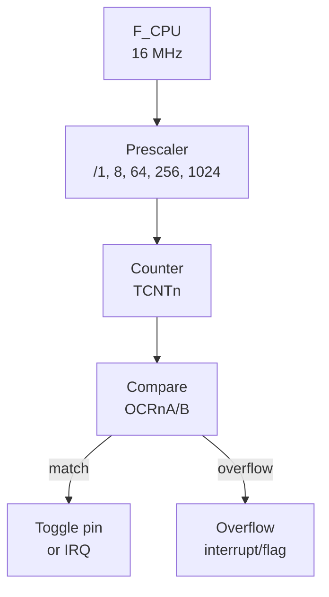

import TawkWidget from '../../../../components/TawkWidget.astro';
import UniversalContentContributors from '../../../../components/UniversalContentContributors.astro';
import InArticleAd from '../../../../components/InArticleAd.astro';
import Copyright from '../../../../components/Copyright.astro';
import BionicText from '../../../../components/BionicText.astro';
import TailwindWrapper from '../../../../components/TailwindWrapper.jsx';
import { Tabs, TabItem } from '@astrojs/starlight/components';
import { Card, CardGrid, Badge, Steps, LinkButton, FileTree } from '@astrojs/starlight/components';

<UniversalContentContributors 
  contributors={frontmatter.contributors}
/>


import PodcastEmbed from '../../../../components/PodcastEmbed.astro';

import EmbeddedProgrammingAtmega328pComments from '../../../../components/embedded-programming-atmega328p/EmbeddedProgrammingAtmega328pComments.astro';

A program that keeps time with a delay loop can do nothing else while it waits. It cannot read a button during the delay, and a tone made this way changes pitch whenever the program does other work. A timer removes the problem: it is a counter built in hardware that counts clock cycles by itself, whatever the program is doing. The ATmega328P has three timers. In this lesson you use one of them to build a tone generator: two buttons step the pitch up and down, and the timer drives a piezo buzzer directly, so you hear what each setting does. #Timers #CTC #PWM

<PodcastEmbed src="https://open.spotify.com/episode/2lQEZPMY8cpp8XPVwukUL0?si=heWxjaGaSjaHnCwWzdW3ig" />

## What We Are Building

<Card title="Tunable Tone Generator" icon="star">
A piezo buzzer on pin OC1A, a pin that Timer1 can switch by itself. Two push buttons move the pitch up and down in semitones (the smallest step between two notes on a piano) across two octaves, from C4 (262 Hz) to C6 (1047 Hz). Two numbers that you write into the timer set the frequency: the prescaler and the compare value. No delay loop takes part in making the tone.
</Card>

**Project specifications:**

| Parameter | Value |
|-----------|-------|
| MCU | ATmega328P (on Arduino Nano or Uno) |
| Timer | Timer1 (16-bit) in CTC mode |
| Output pin | OC1A (PB1, Arduino D9) |
| Frequency range | 262 Hz to 1047 Hz |
| Steps | Semitone increments (12 per octave) |
| Prescaler | 8 (gives good resolution in audible range) |
| Buttons | Up (PD6), Down (PD7) |

### Parts for This Lesson

| Ref | Component | Quantity | Notes |
|-----|-----------|----------|-------|
| 1 | Arduino Nano or Uno (ATmega328P) | 1 | Already in your kit |
| 2 | Breadboard | 1 | Already in your kit |
| 3 | Piezo buzzer (passive) | 1 | Passive: it plays the frequency you give it. An active buzzer plays only its own tone |
| 4 | Push buttons (tactile) | 2 | Reuse 1 from the electronic dice, add 1 new |
| 5 | Jumper wires | ~8 | Male-to-male |


## Timer Architecture Overview

<InArticleAd />


A timer has three parts, and each one solves a problem:

1. The counter (register TCNTn, where n is the timer number) adds 1 on every tick of its clock. Counting ticks of a known length is how hardware measures time.
2. The prescaler slows the ticks. The system clock ticks 16 million times a second, so a counter fed directly from it is full in a few milliseconds. The prescaler passes on only every 8th, 64th, 256th or 1024th tick.
3. The compare register (OCRnA) holds a number you choose. When the counter equals it, the hardware acts: it switches a pin, or raises an interrupt (a signal that makes the processor run a piece of your code).

A counter that passes its largest value starts again at 0. This is called overflow.



Timer0 and Timer2 are 8-bit: they count from 0 to 255. Timer1 is 16-bit and counts from 0 to 65,535, so it can time longer intervals and set a frequency in finer steps. Each timer has two compare registers, A and B, and each compare register has its own output pin. The last column lists features that later lessons use.

| Timer | Width | Compare Channels | PWM Pins | Special Features |
|-------|-------|-------------------|----------|-----------------|
| Timer0 | 8-bit | OCR0A, OCR0B | OC0A (PD6), OC0B (PD5) | Used by Arduino delay() |
| Timer1 | 16-bit | OCR1A, OCR1B | OC1A (PB1), OC1B (PB2) | Input capture, 16-bit resolution |
| Timer2 | 8-bit | OCR2A, OCR2B | OC2A (PB3), OC2B (PD3) | Async mode with external 32 kHz crystal |

### Timer Modes

The mode decides where the counter turns back and what the output pin does. This lesson uses CTC. MAX is the largest value the counter can hold.

| Mode | How It Works | Use Case |
|------|-------------|----------|
| Normal | Counts 0 to MAX, overflows to 0 | Simple timing, overflow interrupts |
| CTC (Clear Timer on Compare) | Counts 0 to OCRnA, resets to 0 | Precise frequency generation |
| Fast PWM | Counts 0 to MAX (or OCRnA), single slope | LED dimming, motor speed |
| Phase Correct PWM | Counts up then down, dual slope | Smoother analog output |

### Prescaler Options

Without a prescaler, each count lasts 62.5 nanoseconds. An 8-bit timer is then full after 16 microseconds, and the 16-bit timer after 4.1 ms. Neither can time a tenth of a second. With prescaler 8 the timer clock is 16 MHz / 8 = 2 MHz, so each count lasts 0.5 microseconds and Timer1 is full after 32.8 ms.

The price is resolution: a larger prescaler makes each count longer, so times and frequencies can be set only in coarser steps. Choose the smallest prescaler whose longest period covers what you need. In the table, us means microseconds. To see how prescalers are built from logic, read [Digital Electronics: Counters, Timers, and Dividers](/education/digital-electronics/counters-timers-dividers/).

| Prescaler | Timer Clock (at 16 MHz) | Tick Period | 8-bit Max Period | 16-bit Max Period |
|-----------|------------------------|-------------|-------------------|-------------------|
| 1 | 16 MHz | 62.5 ns | 16 us | 4.1 ms |
| 8 | 2 MHz | 500 ns | 128 us | 32.8 ms |
| 64 | 250 kHz | 4 us | 1.024 ms | 262 ms |
| 256 | 62.5 kHz | 16 us | 4.096 ms | 1.049 s |
| 1024 | 15.625 kHz | 64 us | 16.384 ms | 4.194 s |

## CTC Mode Frequency Formula

<InArticleAd />


CTC means Clear Timer on Compare. The counter counts from 0 up to the value in OCRnA and then starts again at 0. If you also tell the hardware to toggle (invert) the output pin at each match, the pin produces a square wave, and a square wave on a buzzer is a tone. A smaller compare value means a shorter count, so the pitch is higher.

```text
  TCNTn
    ^
    |     /|    /|    /|    /|
  OCRnA /  |  /  |  /  |  /  |
    | /    |/    |/    |/    |
    +------+-----+-----+------> time
           reset reset reset

  OC1A pin (toggle mode):
    ____      ____      ____
   |    |    |    |    |    |
   |    |____|    |____|    |___
   |<------->|
   one period = 2*(1+OCRnA) ticks
```

Two details set the formula. The counter passes through the values 0 to OCR1A, which is 1 + OCR1A ticks. And the pin changes once at each match, so one full wave (high, then low) needs two matches. The output frequency in hertz is therefore the timer clock divided by 2 × (1 + OCR1A):

```
f_out = F_CPU / (2 * prescaler * (1 + OCR1A))
```

`F_CPU` is the system clock in hertz and `prescaler` is the division you chose. Solving for OCR1A:

```
OCR1A = (F_CPU / (2 * prescaler * f_out)) - 1
```

For example, to generate 440 Hz (the note A4) with prescaler 8:

```
OCR1A = (16000000 / (2 * 8 * 440)) - 1
      = (16000000 / 7040) - 1
      = 2272.7 - 1 = 2271.7, rounded to 2272
```

OCR1A holds only whole numbers, so the real tone is 16000000 / (2 × 8 × 2273) = 439.95 Hz. The error is too small to hear.

## Semitone Frequency Table

<InArticleAd />


Each semitone is the frequency of the note before it multiplied by the twelfth root of 2 ($\sqrt[12]{2} \approx 1.0595$), so 12 semitones, one octave, double the frequency. The table gives the OCR1A values from Middle C (C4) upward, calculated with prescaler 8 from the exact frequencies (for example C4 = 261.63 Hz). The frequency column is rounded to the nearest hertz.

| Note | Frequency (Hz) | OCR1A (prescaler 8) |
|------|----------------|---------------------|
| C4 | 262 | 3821 |
| C#4 | 277 | 3607 |
| D4 | 294 | 3404 |
| D#4 | 311 | 3213 |
| E4 | 330 | 3033 |
| F4 | 349 | 2862 |
| F#4 | 370 | 2702 |
| G4 | 392 | 2550 |
| G#4 | 415 | 2407 |
| A4 | 440 | 2272 |
| A#4 | 466 | 2144 |
| B4 | 494 | 2024 |
| C5 | 523 | 1910 |
| C6 | 1047 | 955 |

## Complete Firmware

<InArticleAd />


Two registers configure Timer1. In `TCCR1A`, the bit `COM1A0` makes the timer toggle pin OC1A. In `TCCR1B`, `WGM12` selects CTC mode and `CS11` selects prescaler 8, which also starts the counter. After that, the main loop only reads the buttons and writes a new value to `OCR1A`.

```c
#define F_CPU 16000000UL

#include <avr/io.h>
#include <util/delay.h>

/* OCR1A values for C4 to C6 (25 semitones, prescaler 8) */
static const uint16_t notes[] = {
    3821, 3607, 3404, 3213, 3033, 2862,  /* C4  to F4  */
    2702, 2550, 2407, 2272, 2144, 2024,  /* F#4 to B4  */
    1910, 1803, 1702, 1606, 1516, 1431,  /* C5  to F5  */
    1350, 1275, 1203, 1135, 1072, 1011,  /* F#5 to B5  */
    955                                    /* C6         */
};

#define NUM_NOTES (sizeof(notes) / sizeof(notes[0]))
#define BTN_UP   PD6
#define BTN_DOWN PD7

static uint8_t debounce(uint8_t pin)
{
    if (!(PIND & (1 << pin))) {
        _delay_ms(50);
        if (!(PIND & (1 << pin)))
            return 1;
    }
    return 0;
}

int main(void)
{
    /* OC1A (PB1) as output for tone */
    DDRB |= (1 << PB1);

    /* Buttons as inputs with pull-ups */
    DDRD &= ~((1 << BTN_UP) | (1 << BTN_DOWN));
    PORTD |= (1 << BTN_UP) | (1 << BTN_DOWN);

    /* Timer1: CTC mode, toggle OC1A on compare match, prescaler 8 */
    TCCR1A = (1 << COM1A0);              /* Toggle OC1A on match */
    TCCR1B = (1 << WGM12) | (1 << CS11); /* CTC mode, prescaler 8 */

    uint8_t note_idx = 9;  /* Start at A4 (440 Hz) */
    OCR1A = notes[note_idx];

    while (1) {
        if (debounce(BTN_UP)) {
            if (note_idx < NUM_NOTES - 1) {
                note_idx++;
                OCR1A = notes[note_idx];
            }
            while (!(PIND & (1 << BTN_UP)));  /* Wait for release */
            _delay_ms(50);
        }

        if (debounce(BTN_DOWN)) {
            if (note_idx > 0) {
                note_idx--;
                OCR1A = notes[note_idx];
            }
            while (!(PIND & (1 << BTN_DOWN)));
            _delay_ms(50);
        }
    }
}
```

## How the Hardware Toggle Works

<InArticleAd />


Once the two registers are set, the hardware toggles OC1A at every match and returns the counter to 0, without any code. This is why the tone stays steady while the program waits 50 ms in the debounce delay.

## PWM Mode Preview

<InArticleAd />


A digital pin is only fully on or fully off, so it cannot dim an LED or slow a motor directly. Pulse width modulation (PWM) switches the pin on and off at a fixed frequency, too fast to see, and changes the fraction of each cycle that the pin is on. That fraction is the duty cycle, and it sets the average power the load receives.

Fast PWM mode uses the same counter and compare register. The counter always runs to MAX. The pin goes high when the counter starts at 0 and low at the compare match, so the compare value now sets the width of the pulse, not the frequency.

```text
  TCNTn
    ^
 MAX|    /|    /|    /|
    |   / |   / |   / |
 OCR|--/--+--/--+--/--+-- duty cycle
    | /   | /   | /   |
    |/    |/    |/    |
    +-----+-----+-----+-----> time

  Output pin:
    ___   ___   ___
   |   | |   | |   |
   |   |_|   |_|   |_______
    <-->
    duty ~ OCRnA / MAX
```

The exact fast PWM duty cycle is $(\text{OCRnA} + 1) / (\text{MAX} + 1)$, so OCR0A = 127 on an 8-bit timer gives $128 / 256 = 50\%$. Later lessons use PWM for motor speed and LED dimming.

```c
/* Example: Fast PWM on Timer0, ~62.5 kHz, 50% duty */
TCCR0A = (1 << COM0A1) | (1 << WGM01) | (1 << WGM00);
TCCR0B = (1 << CS00);  /* No prescaler */
OCR0A = 127;            /* 50% duty cycle */
DDRD |= (1 << PD6);    /* OC0A output */
```

:::tip[Instrument it]
A timer can also count pulses that come from outside, and then it is a measuring instrument. Give it the pulses of a Hall sensor that watches a magnet on a shaft, and it counts revolutions: a tachometer. The same method on the pulse output of a flow meter reads litres per minute. An [ATmega](/education/sensor-actuator-interfacing-stm32/) measures it, and an [ESP32 or STM32 link](/education/iot-systems/) can [log RPM or flow](https://siliconwit.io) to catch a belt slipping or a pump losing prime.
:::

## Exercises

<InArticleAd />


1. Add a third button that mutes the tone by disconnecting the output compare (clear COM1A0 in TCCR1A) and re-enables it on the next press.
2. Program a melody: store a sequence of note indices and durations in an array, then play them in order using Timer1 for the tone and a delay loop for timing.
3. Use Timer0 in Normal mode with an overflow interrupt to create a 1 ms system tick. Use this tick to implement a non-blocking button debouncer.
4. Calculate the exact frequency error for each note in the semitone table. How far off is each note from the ideal frequency, and which notes have the largest error?

## Summary

<InArticleAd />


A timer is a counter that hardware advances, a prescaler that slows its ticks, and a compare register that acts when the counter reaches your number. In CTC mode with a toggling pin, the prescaler and OCR1A together set the frequency, and the tone continues with no code running. The same three parts produce PWM and the timed interrupts of the next lessons.

<EmbeddedProgrammingAtmega328pComments />


<InArticleAd />
<TawkWidget />
<Copyright />
